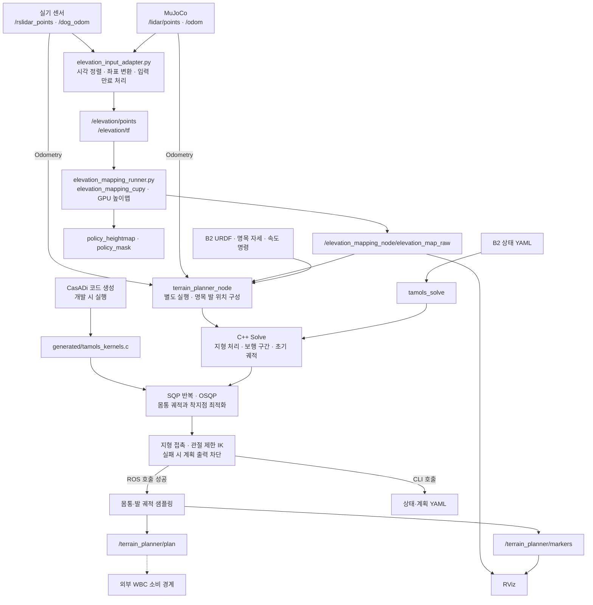

# B2 지형 맵·상위 계획

B2 센서 또는 MuJoCo의 점군·odometry로 GPU 높이맵을 만들고, C++ TAMOLS 계획기로
몸통 CoM 궤적과 착지점을 계산한다. ROS 노드는 계획과 RViz 마커를 발행하고,
`tamols_solve`는 B2 상태 YAML을 읽어 독립적으로 계획을 계산한다.

이 저장소의 범위는 **센서 입력 → 지형 맵 → 상위 계획 → ROS 출력**이다.
WBC·모터 제어·MuJoCo 실행파일은 별도 `b2_deploy_ws`가 소유한다.
이 저장소에는 pRbLibrary 소스나 서브모듈이 없으며, B2 URDF 복제본만 포함한다.

## 전체 워크플로우



맵 launch는 입력 어댑터·맵·선택적 RViz를 실행한다. `terrain_planner_node`는 별도로
실행해야 한다. 점선은 외부 연동 경계이며, 이 저장소만으로 WBC 추종 완료를 보장하지 않는다.

계획기는 trot의 지지 구간을 구성하고, 이전 계획이 호환되면 warm start를 사용한다.
생성 C 커널로 비용·GIAC·마찰·기구학 제약과 미분을 평가하며, C++에서 QP 구성,
등식 처리, 비선형 제약 보정과 line search를 수행한다. OSQP는 각 QP를 푼다.
최종 지형 접촉과 관절 제한 IK를 확인한 뒤 성공한 계획을 출력한다.

## 저장소 구조

```text
b2_terrain_planning/
├── b2_terrain_planner/
│   ├── src/, include/    # SQP, 지형, RBDL 모델, CLI, ROS 노드
│   ├── codegen/         # CasADi 수식과 C 미분 커널 생성기
│   ├── generated/       # 일반 빌드에서 사용하는 생성 C 코드
│   ├── model/           # B2 URDF와 출처
│   ├── msg/             # LocomotionPlan 메시지
│   ├── config/          # 센서·맵·RViz·B2 상태 설정
│   └── scripts/, launch/# 실기·시뮬 맵 실행
├── scripts/build.sh     # CPU 또는 ROS overlay 빌드
├── docs/                # 맵 운영 절차와 외부 소스 기준
└── patches/             # 외부 CuPy 포크 재현용 패치
```

시험·벤치마크·Python 참조 구현과 누적 실험 기록은 제거했다. 변경 이력은 Git에서 관리한다.
실행 로그·임시 산출물은 `build/`, `.perception/` 등 Git 제외 경로에 둔다.

## 빌드

CPU 계획기에는 CMake, C++17, Eigen3, yaml-cpp, LAPACK(LP64), pkg-config, tinyxml2,
RBDL 및 URDF reader, **OSQP 0.6.x double-precision C API(PROFILING 포함)**가 필요하다.
기존 환경의 기준은 OSQP 0.6.3, RBDL 3.3.1, tinyxml2 9.0.0이다.
OSQP 1.x는 C API가 달라 직접 호환되지 않는다.

```bash
# 저장소 루트에서 CPU 계획기만 빌드
./scripts/build.sh --cpu-only

# ROS 2 Humble + 맵 overlay 빌드
./scripts/build.sh
```

CPU 산출물은 `build/`, ROS 산출물은 `.perception/`에 생성한다.
CPU 빌드와 실행에는 ROS·GPU·CasADi·IPOPT가 필요하지 않다.
OSQP 위치는 CMake의 `OSQP_INCLUDE_DIR`, `OSQP_LIBRARY`,
RBDL 위치는 `RBDL_DIR` 또는 `CUSTOM_RBDL_PATH`로 지정할 수 있다.

ROS 빌드는 같은 워크스페이스의 `elevation_mapping_cupy`와 `ros2_numpy`도 사용한다.
맵 실행에는 NVIDIA GPU·CUDA·CuPy와 해당 Python 환경이 필요하다.
`B2_WS_ROOT`로 워크스페이스, `ELEVATION_BUILD_ROOT`로 overlay 산출물 위치를 바꿀 수 있다.

## B2 YAML 계획 실행

```bash
./build/tamols_solve --input b2_terrain_planner/config/planner_b2_example.yaml
./build/tamols_solve --speed 0.1 --fast-replanning
./build/tamols_solve --help
```

`model_state`는 base 위치·quaternion, 월드 선속도, 몸통 각속도, 관절 위치·속도를 받는다.
RBDL로 FK·CoM·질량·CoM 기준 관성을 계산한다. 관절 순서는 FL/FR/RL/RR × hip/thigh/calf다.
`model_path`는 입력 YAML 기준 상대 경로 또는 절대 경로이며, 생략하면 포함된 B2 URDF를 쓴다.
`command`는 몸통 기준 `[vx, vy, yaw_rate]`다. `gait_time`, `nominal`, `fixed`도 입력할 수 있다.

정적 지형은 `terrain`의 `frame`, `resolution`, `origin`, `heights`, `variance`, `valid`로
전달한다. 배열은 행=Y, 열=X 증가 방향이며, `origin`은 최소 모서리 좌표다.
입력 `frame`과 지형 `frame`이 일치해야 한다. `terrain_settings`에서 평활 폭·분산 상한·
접촉 오차·지형 비용을 조정할 수 있다. 필드와 기본값은
[terrain.h](b2_terrain_planner/include/b2_terrain_planner/terrain.h)를 따른다.

출력은 상태·시간·제약 위반·모델 정보이며, 성공할 때만 착지점과 구간별 다항식 계수가
포함된다. 좌표 순서는 CoM XYZ, yaw/pitch/roll(ZYX)이고 계수의 시간 단위는 실제 초다.
`converged`, `feasible_stalled`, `feasible_realtime_step`은 각각 수치 수렴, 가능한 해에서의
정체, warm start 이후 제한 반복 갱신을 구분한다. `--time-limit`은 계산 예산이다.
`--profile`은 시간·QP 상태를 추가 출력한다.

`--warm-start <이전 출력.yaml>`은 현재 B2 상태와 함께 이전 계획을 넘긴다.
모델·프레임·지형·보행 주기의 호환성을 확인한 뒤 사용하며, 호환되지 않으면 새로 초기화한다.
`--fast-replanning`은 QP 재사용·구조 등식·LAPACK 등을 묶은 CLI 프리셋이다.
ROS 노드의 QP 정규화·반복 수·허용 오차와는 값이 다르다.

합성 모델, 제약 해제, 상세 line-search 추적, 이상 추종 재생 CLI는 제공하지 않는다.
이전 출력의 제약 해제 표시가 참이면 warm start 입력을 거부한다.

## 맵과 ROS 계획 실행

```bash
# 이미 실행 중인 MuJoCo 센서에 맵과 RViz 연결
./b2_terrain_planner/scripts/run_elevation_sim.sh --rviz

# 실기 센서에 맵과 RViz 연결: NIC 이름은 실제 환경에 맞춘다
./b2_terrain_planner/scripts/run_elevation_real.sh --interface enp3s0 --rviz
```

시각 동기화·DDS·장착 TF·입력 만료 처리는
[맵 운영 절차](docs/elevation_map_runtime.md)를 따른다.

계획 노드는 별도 터미널에서 실행한다. 아래 예시는 `/odom`의 수치 좌표가
맵의 `elevation_odom`과 같은 원점·방향이라는 전제다. 노드 내부에서 TF 변환하지 않는다.

```bash
source /opt/ros/humble/setup.bash
source .perception/install/local_setup.bash
ros2 run b2_terrain_planner terrain_planner_node --ros-args \
  -p odom_topic:=/odom -p frame:=elevation_odom
```

실기에서는 `odom_topic:=/dog_odom`을 사용하며, 해당 odometry와 맵의 몸통·좌표 계약을
먼저 맞춰야 한다. 발행 메시지·마커는 odometry의 `header.frame_id`를 사용하므로
RViz의 Fixed Frame과 연결되는 TF도 필요하다.

| ROS 노드 설정 | 기본값 |
|---|---|
| `odom_topic` | `/odom` |
| `map_topic` | `/elevation_mapping_node/elevation_map_raw` |
| `frame` | `odom` — 입력 맵은 기본 `elevation_odom`이므로 실행 시 확인 |
| `command` | `[0.1, 0.0, 0.0]` |
| `plan_rate_hz`, `time_limit` | 10 Hz, 0.1 s |
| `sample_dt`, `swing_height` | 0.02 s, 0.10 m |
| `require_map`, `publish_markers` | true, true |
| `plan_topic`, `marker_topic` | `/terrain_planner/plan`, `/terrain_planner/markers` |

## 현재 ROS 연결의 구현 범위

- 관절·실측 발 위치를 구독하지 않는다. 모델은 명목 자세로 초기화하고, 매 계획마다
  odometry 자세와 hip 아래 지형 높이로 초기 발 위치를 구성한다.
- 몸통 입력의 위치는 odometry base 위치를 사용하지만, 계획기의 좌표 계약은 CoM이다.
  현재 노드에서 base→CoM 보정을 수행하지 않는다.
- `LocomotionPlan.base_pose`는 계획기의 CoM 궤적을 그대로 담는다.
  `base_twist.angular`는 메시지 주석과 달리 roll/pitch/yaw의 시간 미분이며,
  월드 각속도로 변환하지 않는다. WBC 연결 시 이 차이를 해소해야 한다.
- 스윙 발은 시작점과 착지점을 보간하고 sine 높이를 더해 생성한다.
  전체 관절 궤적·스윙 충돌 회피를 계산하는 구현은 아니다.
- 맵·odom의 TF 변환과 수신 데이터 만료 판정은 계획 노드에 없다.
  입력 어댑터의 맵 발행 중단과 별개로 노드에 마지막 데이터가 남을 수 있다.
- GIAC는 계획 시작 자세의 관성을 고정하는 SRBD 근사다. 최종 지지발·착지점 IK가
  전체 스윙 경로나 실제 로봇의 추종 가능성을 보장하지 않는다.

위 항목은 현재 구현의 연결 경계다. 이번 정리는 제어 알고리즘이나 ROS 메시지를 변경하지 않는다.

## 확인 범위

정리 후 CPU Release 빌드와 ROS 메시지·노드의 CMake 빌드·설치를 확인했다.
정지·보행·고속 프리셋·평탄 높이맵·잘못된 입력·warm start의 6개 입력을 정리 전과
비교해 종료 상태와 반복 수가 같음을 확인했다. 각 구간 101개 표본에서 CoM 위치·자세의
최대 절댓값 차이는 약 `2.3e-9`(각 성분의 m 또는 rad), 착지점 차이는 `1.9e-10 m` 이하였다.
새 출력 형식의 warm start, QP 상태 출력, 폐기 옵션과 과거 제약 해제 계획의 거부도 확인했다.

ROS 구성 후 `colcon`이 다음 단계로 진행하지 않아 CMake 직접 빌드·설치로 확인했다.
설치된 CLI 실행과 ROS 노드의 공유 라이브러리 연결을 확인했으며, 이번 정리에서
GPU 맵·RViz·실기 WBC 통합 실행은 수행하지 않았다. 상세 변경·검증 내역은 Git 커밋에 남긴다.

## 커널 생성과 외부 소스 관리

`codegen/generate_kernels.py`는 Python 참조 구현 없이 독립적으로 C 커널을 생성한다.
일반 빌드에는 이미 포함된 `generated/`를 사용한다. 수식 변경 시 CasADi 3.7.2와 NumPy가
있는 환경에서 다음 명령을 실행하고 생성 C·헤더·manifest를 함께 검토한다.

```bash
python3 b2_terrain_planner/codegen/generate_kernels.py
```

B2 모델의 기준 커밋·해시는 [모델 출처](b2_terrain_planner/model/README.md),
외부 맵 저장소의 기준은 [source_manifest.json](docs/source_manifest.json)에 기록한다.
`patches/elevation_mapping_cupy.patch`는 외부 CuPy 포크의 발밑 보호·정책 크롭을
재현하는 자료다. 기존 환경에는 적용되어 있으므로 중복 적용하지 않는다.
새 환경에서는 기록된 기준 커밋에서 `git apply --check` 후 적용한다.
다른 로봇 저장소는 별도 요청 없이 수정하거나 동기화하지 않는다.
