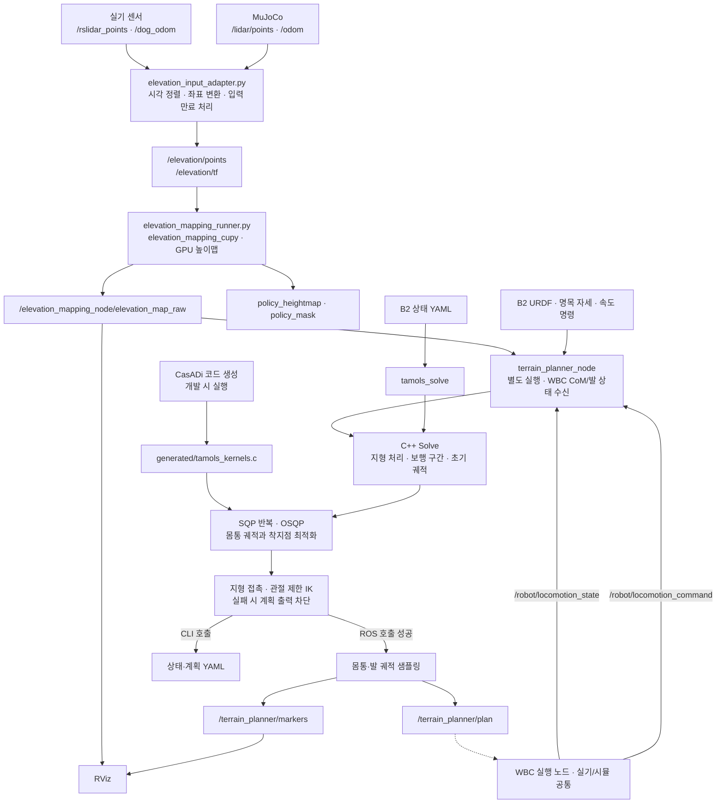

# B2 지형 맵·상위 계획

WBC와 함께 사용하는 통합 실행은 `b2_deploy_ws/scripts/run_laptop.sh`가 담당한다.
GUI·RViz·지도·TAMOLS·시각화 TF를 함께 실행하고, 지도 입력은 `/kf/odom`으로 맞춘다.
로봇 측은 `b2_deploy_ws/scripts/run_robot.sh`로 실행한다(개발 PC 기본 MuJoCo).
자세한 사용법은 [두 역할 실행 문서](../b2_deploy_ws/docs/two_process_runtime.md)를 따른다.
통합 설정에서는 로봇이 제어권을 검증해 발행한 `/robot/locomotion_command`
(`geometry_msgs/TwistStamped`)를 속도 목표로 사용한다. `base_heading`의 수평 전후/좌우
속도와 yaw 속도이며, 기본 0.25초 동안 새 명령이 없으면 0으로 처리한다.
`/terrain_planner_node/effective_command`에서 실제 계획 입력에 사용하는 값을 확인할 수 있다.
단독 실행의 고정 `command` 파라미터는 `command_topic`이 비어 있을 때만 사용한다.
통합 설정은 현재 접촉 발 주변에 발 링크 높이와 같은 국소 지면을 가정하는 임시 보정을 켠다.
명령 전달 및 국소 지도 보정과 전체 폐루프 보행 성공은 별도로 검증한다.
아래의 GT/실기 센서 전용 맵 실행은 개별 진단용 경로다.

평지 알고리즘 검증은 두 실행기에 모두 `--flat`을 붙인다. 별도 평면 MuJoCo XML과
기존 LiDAR/CuPy 지도를 사용하고, 입력 GridMap의 구조를 유지한 채 높이·분산·유효성만
평탄화한다. 평면 높이는 최근 유효 센서 관측을 따라 갱신해 odometry 드리프트를 반영한다.
초기 발 링크/지면 높이 차이만 고정 오프셋으로 유지한다. TAMOLS와 RViz는 `/terrain_planner/elevation_map_flat`을 받는다.
정지·전진·회전의 단발 계획은 검증했다. 초기 발 높이 검사는 스윙 구간과 실제 비접촉 발을
제외하도록 수정했으며, 계산 시간 제한과 접촉·궤적 연결을 포함한 연속 보행 검증은 별도다.
실행 순서, 재현 명령과 확인된 한계는 [평지 검증 문서](docs/flat_validation.md)를 따른다.

B2 센서 또는 MuJoCo의 점군·odometry로 GPU 높이맵을 만들고, C++ TAMOLS 계획기로
몸통 CoM 궤적과 착지점을 계산한다. ROS 노드는 계획과 RViz 마커를 발행하고,
`tamols_solve`는 B2 상태 YAML을 읽어 독립적으로 계획을 계산한다.

이 저장소의 범위는 **센서 입력 → 지형 맵 → 상위 계획 → ROS 출력**이다.
WBC·모터 제어·MuJoCo 실행파일은 별도 `b2_deploy_ws`가 소유한다.
이 저장소에는 pRbLibrary 소스나 서브모듈이 없으며, B2 URDF 복제본만 포함한다.

## 접촉 발 주변 임시 지도 보정

`terrain_planner_wbc.yaml`의 `support_patch.enabled: true`이면, 최신 유효 상태의
`contact_estimated=true`인 발 주변을 그 발의 Z 높이로 채운 뒤 TAMOLS에 전달한다.
이미 관측된 높이도 같은 범위에서는 덮어쓴다. `support_patch.half_width: 0.30`은
발 중심에서 X/Y 각 방향 30 cm인 사각 영역이며, 지도 필터·미분·보간에 필요한
최소 반폭이 더 크면 자동으로 넓힌다. 겹친 셀은 XY 거리가 가장 가까운 접촉 발을 따른다.

이것은 발 링크 원점을 접촉점처럼 취급하는 사용자 선택의 임시 가정이다.
보정한 셀은 유효 셀로, 분산은 0으로 지정한다. 물리적인 접촉점/발 두께 보정은 아니다.
공중의 발을 기준으로 지면을 채우지 않으며, 범위 밖의 관측값과 미관측 셀은 유지한다.
원본 GridMap은 보존하고 매 solve의 입력 복사본만 변경하므로 보정 이력이 누적되지 않는다.
따라서 RViz의 원본 elevation map에는 이 보정이 표시되지 않는다.
지도 또는 상태가 만료되면 기존과 같이 계획을 중단하며 지도가 아예 없을 때 생성하지 않는다.

단독 ROS 실행은 보정이 기본 OFF이다. 통합 YAML에서 `support_patch.enabled: false`로
원래 동작으로 되돌릴 수 있다. 셀 중심 좌표는 GridMap 모서리에서 반 셀 안쪽으로 맞췄다.

검증: `support_patch_test`는 2/5/10 cm 해상도에서 발 높이 조회, 겹침, 접촉 마스크,
지도 경계와 보정 밖 셀 보존을 통과했다. `locomotion_state_ros_test.py --support-patch`는
앞쪽 미관측/뒤쪽 32 mm 높이 차이 입력으로 실제 ROS 계획 발행과 상태·지도 만료를 확인했다.
이 ROS 계약 시험의 solve 제한은 3초이며, 운용 설정의 0.1초 제한이나 폐루프 보행을
검증한 결과는 아니다.

## 전체 워크플로우



맵 launch는 입력 어댑터·맵·선택적 RViz를 실행한다. `terrain_planner_node`는 별도로
실행해야 한다. 점선은 외부 연동 경계이며, 이 저장소만으로 WBC 추종 완료를 보장하지 않는다.

계획기는 trot의 지지 구간을 구성하고, 이전 계획이 호환되면 warm start를 사용한다.
생성 C 커널로 비용·GIAC·마찰·기구학 제약과 미분을 평가하며, C++에서 QP 구성,
등식 처리, 비선형 제약 보정과 line search를 수행한다. OSQP는 각 QP를 푼다.
최종 지형 접촉과 관절 제한 IK를 확인한 뒤 성공한 계획을 출력한다.

## 저장소 구조

```text
b2_terrain_planning/
├── b2_terrain_planner/
│   ├── src/, include/    # SQP, 지형, RBDL 모델, CLI, ROS 노드
│   ├── codegen/         # CasADi 수식과 C 미분 커널 생성기
│   ├── generated/       # 일반 빌드에서 사용하는 생성 C 코드
│   ├── model/           # B2 URDF와 출처
│   ├── msg/             # LocomotionPlan 메시지
│   ├── config/          # 센서·맵·RViz·B2 상태 설정
│   └── scripts/, launch/# 실기·시뮬 맵 실행
├── scripts/build.sh     # CPU 또는 ROS overlay 빌드
├── docs/                # 맵 운영 절차와 외부 소스 기준
└── patches/             # 외부 CuPy 포크 재현용 패치
```

기존 누적 실험 기록과 Python 참조 구현은 제거했다. 현재 계약 시험과 평지 재현 도구는
`b2_terrain_planner/tests/`에 유지하고, 변경 이력은 Git에서 관리한다.
실행 로그·임시 산출물은 `build/`, `.perception/` 등 Git 제외 경로에 둔다.

## 빌드

CPU 계획기에는 CMake, C++17, Eigen3, yaml-cpp, LAPACK(LP64), pkg-config, tinyxml2,
RBDL 및 URDF reader, **OSQP 0.6.x double-precision C API(PROFILING 포함)**가 필요하다.
기존 환경의 기준은 OSQP 0.6.3, RBDL 3.3.1, tinyxml2 9.0.0이다.
OSQP 1.x는 C API가 달라 직접 호환되지 않는다.

```bash
# 저장소 루트에서 CPU 계획기만 빌드
./scripts/build.sh --cpu-only

# ROS 2 Humble + 맵 overlay 빌드
./scripts/build.sh
```

CPU 산출물은 `build/`, ROS 산출물은 `.perception/`에 생성한다.
CPU 빌드와 실행에는 ROS·GPU·CasADi·IPOPT가 필요하지 않다.
OSQP 위치는 CMake의 `OSQP_INCLUDE_DIR`, `OSQP_LIBRARY`,
RBDL 위치는 `RBDL_DIR` 또는 `CUSTOM_RBDL_PATH`로 지정할 수 있다.

ROS 빌드는 같은 워크스페이스의 `elevation_mapping_cupy`와 `ros2_numpy`도 사용한다.
맵 실행에는 NVIDIA GPU·CUDA·CuPy와 해당 Python 환경이 필요하다.
`B2_WS_ROOT`로 워크스페이스, `ELEVATION_BUILD_ROOT`로 overlay 산출물 위치를 바꿀 수 있다.

## B2 YAML 계획 실행

```bash
./build/tamols_solve --input b2_terrain_planner/config/planner_b2_example.yaml
./build/tamols_solve --speed 0.1 --fast-replanning
./build/tamols_solve --help
```

`model_state`는 base 위치·quaternion, 월드 선속도, 몸통 각속도, 관절 위치·속도를 받는다.
RBDL로 FK·CoM·질량·CoM 기준 관성을 계산한다. 관절 순서는 FL/FR/RL/RR × hip/thigh/calf다.
`model_path`는 입력 YAML 기준 상대 경로 또는 절대 경로이며, 생략하면 포함된 B2 URDF를 쓴다.
`command`는 몸통 기준 `[vx, vy, yaw_rate]`다. `gait_time`, `nominal`, `fixed`도 입력할 수 있다.

정적 지형은 `terrain`의 `frame`, `resolution`, `origin`, `heights`, `variance`, `valid`로
전달한다. 배열은 행=Y, 열=X 증가 방향이며, `origin`은 최소 모서리 좌표다.
입력 `frame`과 지형 `frame`이 일치해야 한다. `terrain_settings`에서 평활 폭·분산 상한·
접촉 오차·지형 비용을 조정할 수 있다. 필드와 기본값은
[terrain.h](b2_terrain_planner/include/b2_terrain_planner/terrain.h)를 따른다.

출력은 상태·시간·제약 위반·모델 정보이며, 성공할 때만 착지점과 구간별 다항식 계수가
포함된다. 좌표 순서는 CoM XYZ, yaw/pitch/roll(ZYX)이고 계수의 시간 단위는 실제 초다.
`converged`, `feasible_stalled`, `feasible_realtime_step`은 각각 수치 수렴, 가능한 해에서의
정체, warm start 이후 제한 반복 갱신을 구분한다. `--time-limit`은 계산 예산이다.
`--profile`은 시간·QP 상태를 추가 출력한다.

`--warm-start <이전 출력.yaml>`은 현재 B2 상태와 함께 이전 계획을 넘긴다.
모델·프레임·지형 사용 여부·보행 주기의 호환성을 확인한 뒤 사용한다. 지도 영역 이동이나
관측 갱신만으로 초기 궤적을 폐기하지 않으며, 이전 착지점은 현재 지도에서 다시 검사한다.
범위·높이·도달성에 맞지 않는 목표는 새 후보를 사용하고 최종 지형/IK 검증도 다시 수행한다.
`--fast-replanning`은 QP 재사용·구조 등식·LAPACK 등을 묶은 CLI 프리셋이다.
ROS 노드의 QP 정규화·반복 수·허용 오차와는 값이 다르다.

합성 모델, 제약 해제, 상세 line-search 추적, 이상 추종 재생 CLI는 제공하지 않는다.
이전 출력의 제약 해제 표시가 참이면 warm start 입력을 거부한다.

## 맵과 ROS 계획 실행

```bash
# 이미 실행 중인 MuJoCo 센서에 맵과 RViz 연결
./b2_terrain_planner/scripts/run_elevation_sim.sh --rviz

# 실기 센서에 맵과 RViz 연결: NIC 이름은 실제 환경에 맞춘다
./b2_terrain_planner/scripts/run_elevation_real.sh --interface enp3s0 --rviz
```

시각 동기화·DDS·장착 TF·입력 만료 처리는
[맵 운영 절차](docs/elevation_map_runtime.md)를 따른다.

계획 노드는 별도 터미널에서 실행한다. 시뮬레이션과 실기 모두 WBC 실행 노드의
`/robot/locomotion_state`를 구독한다. WBC task를 실행해 추정 상태가 유효해져야 계획을 시작한다.
맵 입력 odometry도 `/kf/odom`으로 설정해야 한다. 기본 맵 시연 설정의 `/odom` 또는
`/dog_odom`은 KF 좌표와 자동으로 같아지지 않는다.
아래 예시는 맵의 `elevation_odom`이 상태의 `odom`과 같은 원점·방향으로 설정된 경우다.
노드 내부에서 TF 변환하지 않으며 `frame`은 맵 프레임, `state_frame`은 상태 프레임이다.

```bash
source /opt/ros/humble/setup.bash
source ~/ros2_ws/install/local_setup.bash
ros2 run b2_terrain_planner terrain_planner_node --ros-args \
  -p state_topic:=/robot/locomotion_state -p state_frame:=odom -p frame:=elevation_odom
```

발행 계획·마커는 상태 메시지의 `header.frame_id`를 사용한다.
RViz의 Fixed Frame과 연결되는 TF도 같은 좌표 계약에 맞춰야 한다.

| ROS 노드 설정 | 기본값 |
|---|---|
| `state_topic`, `state_frame` | `/robot/locomotion_state`, `odom` |
| `state_max_age`, `map_max_age` | 0.25 s, 1.0 s |
| `map_topic` | `/elevation_mapping_node/elevation_map_raw` |
| `frame` | `odom` — 입력 맵은 기본 `elevation_odom`이므로 실행 시 확인 |
| `command` | `[0.1, 0.0, 0.0]` |
| `plan_rate_hz`, `time_limit` | 10 Hz, 0.1 s |
| `sample_dt`, `swing_height` | 0.02 s, 0.10 m |
| `require_map`, `publish_markers` | true, true |
| `plan_topic`, `marker_topic` | `/terrain_planner/plan`, `/terrain_planner/markers` |

## 현재 ROS 연결의 구현 범위

- `LocomotionState`의 전신 CoM 위치·속도와 네 발 위치를 최적화 초기 상태로 사용한다.
  WBC 실행 노드는 실기에서도 얻는 IMU·관절 q/dq·모터 토크 추정값과 KF/운동학만 사용한다.
  simulator GT base·발·접촉·GRF는 이 메시지의 입력이 아니다.
- 몸통 자세와 world 각속도를 받아 Euler 변화율로 변환한다. 명목 base→CoM 변환은 제거했다.
  질량·관성·도달성 모델의 명목 관절 근사는 여전히 남아 있다.
- 네 발 속도와 `contact_estimated`, `contact_confirmed`를 전달한다. WBC가 착지 확인에 따라
  보행 시간을 정지·재개하며 TAMOLS는 같은 `gait_time`으로 고정 trot 순서를 계획한다.
- 메시지 필드명은 유지한다. `base_pose.position`과 `base_twist.linear`는 전신 CoM,
  `base_pose.orientation`은 몸통 자세, `base_twist.angular`는 roll/pitch/yaw 변화율이다.
  `b2_deploy` bridge가 각속도로 변환하고 WBC는 전신 CoM Jacobian으로 병진을 직접 추종한다.
  base 원점 궤적을 이 메시지의 병진 필드에 넣지 않는다.
- 스윙 발은 위치·속도 경계를 갖는 Hermite 곡선으로 생성한다. 진행 중인 발은 착지점 XYZ를
  최적화 등식 제약으로 고정하고 남은 곡선도 유지한다. 새 명령은 아직 이륙하지 않은 발의
  착지점에 반영한다. CoM은 고정된 착지점을 제약에 사용하면서 계속 재계획한다.
  전체 관절 궤적·스윙 충돌 회피를 계산하는 구현은 아니다.
- 상태와 지도의 시각 만료를 solve 전후 검사한다. 미래·비정상·다른 프레임의 상태와
  중복·역순 시각을 거부한다. 같은 상태로 계획을 반복 발행하지 않고 원래 상태 시각을 보존한다.
  `require_map=false`는 맵 없는 평지 시험용이다. 이미 수신한 맵이 만료되면 이 모드도 계획을 중단한다.
- TF 변환은 수행하지 않는다. `frame`과 `state_frame`의 이름이 달라도 수치 원점·축은 같아야 한다.
  gait 시간은 유효한 WBC 보행 시계를 우선 사용한다. 새 WBC 세션으로 KF 원점이 초기화되면
  계획기와 지도도 재시작해 기존 좌표·계획을 비워야 한다.
- GIAC는 계획 시작 자세의 관성을 고정하는 SRBD 근사다. 최종 지지발·착지점 IK가
  전체 스윙 경로나 실제 로봇의 추종 가능성을 보장하지 않는다.

위 항목은 현재 구현의 연결 경계다. CoM 추종 연결과 실제 지형 폐루프 검증은 구분한다.

## 확인 범위

정리 후 CPU Release 빌드와 ROS 메시지·노드의 CMake 빌드·설치를 확인했다.
정지·보행·고속 프리셋·평탄 높이맵·잘못된 입력·warm start의 6개 입력을 정리 전과
비교해 종료 상태와 반복 수가 같음을 확인했다. 각 구간 101개 표본에서 CoM 위치·자세의
최대 절댓값 차이는 약 `2.3e-9`(각 성분의 m 또는 rad), 착지점 차이는 `1.9e-10 m` 이하였다.
새 출력 형식의 warm start, QP 상태 출력, 폐기 옵션과 과거 제약 해제 계획의 거부도 확인했다.

ROS 구성 후 `colcon`이 다음 단계로 진행하지 않아 CMake 직접 빌드·설치로 확인했다.
설치된 CLI 실행과 ROS 노드의 공유 라이브러리 연결을 확인했으며, 이번 정리에서
GPU 맵·RViz·실기 WBC 통합 실행은 수행하지 않았다. 상세 변경·검증 내역은 Git 커밋에 남긴다.

2026-10-16 CoM 입력 보정 후 `terrain_planner_node` 빌드를 확인했다.
격리 ROS domain에서 합성 base odometry z=0.5120595 m를 보내고, `require_map=false`,
정지 명령으로 발행한 계획의 첫 CoM 위치가 명목 모델 계산값
`[-0.00124548, 0.00252666, 0.49859984]` m와 일치함을 확인했다.
이는 상태 변환·메시지 발행 검증이며 GPU 맵·MuJoCo 폐루프 보행 검증은 아니다.

## 커널 생성과 외부 소스 관리

`codegen/generate_kernels.py`는 Python 참조 구현 없이 독립적으로 C 커널을 생성한다.
일반 빌드에는 이미 포함된 `generated/`를 사용한다. 수식 변경 시 CasADi 3.7.2와 NumPy가
있는 환경에서 다음 명령을 실행하고 생성 C·헤더·manifest를 함께 검토한다.

```bash
python3 b2_terrain_planner/codegen/generate_kernels.py
```

B2 모델의 기준 커밋·해시는 [모델 출처](b2_terrain_planner/model/README.md),
외부 맵 저장소의 기준은 [source_manifest.json](docs/source_manifest.json)에 기록한다.
`patches/elevation_mapping_cupy.patch`는 외부 CuPy 포크의 발밑 보호·정책 크롭을
재현하는 자료다. 기존 환경에는 적용되어 있으므로 중복 적용하지 않는다.
새 환경에서는 기록된 기준 커밋에서 `git apply --check` 후 적용한다.
다른 로봇 저장소는 별도 요청 없이 수정하거나 동기화하지 않는다.

2026-10-16 공통 상태 토픽 연결 검증: `LocomotionState` 생성과 계획기 빌드,
실제 ROS 노드 통합 시험(`b2_terrain_planner/tests/locomotion_state_ros_test.py`)을 통과했다.
전달한 CoM·발 위치가 첫 계획에 반영되는지, 원래 시각 보존, NaN·잘못된 자세/프레임·미래/오래된
상태·중복/역순 메시지 거부, 상태/지도 만료 시 발행 중단을 확인했다.
통합 시험은 메시지 계약 검증을 위해 time_limit=3초, 입력 유효기간=4초로 실행했다.
초기 0.5초 제한에서는 지형 solve가 time_limit으로 실패했으므로 기본 10 Hz 성능이나
MuJoCo 지형 폐루프 보행 성공을 의미하지 않는다. 온보드 배포·실기 구동은 수행하지 않았다.

```bash
# 별도 ROS domain에서 실행: 실제 WBC에 연결하지 않는 합성 상태/지도 시험
ROS_DOMAIN_ID=174 RMW_IMPLEMENTATION=rmw_fastrtps_cpp \
  /usr/bin/python3 src/b2_terrain_planning/b2_terrain_planner/tests/locomotion_state_ros_test.py \
  install/b2_terrain_planner/lib/b2_terrain_planner/terrain_planner_node
```

외부 계획 추종은 WBC 착지 확인에 따라 보행 시간을 정지·재개한다. `LocomotionState/Plan`의 보행 시간 필드를 추가했으므로 두 패키지 재빌드 후 양쪽 실행기를 재시작해야 한다. 평지 폐루프 안정성 검증 결과는 각 패키지 운영 문서를 참조한다.

TAMOLS 추종의 다음 스윙은 이륙 후에도 확인 지지발이 최소 두 개 남을 때 허용한다. 부족하면 이륙 직전에서 기다리며, 대각쌍 대기 시간 0.3초로 종료하지 않는다. 발별 탐색 제한과 계획 만료는 별개다.

## 계획 갱신 중단 진단

`/terrain_planner_node/pipeline_status`는 JSON 문자열로 각 보류·solve·발행 이벤트를 기록한다.
`event_seq`는 이벤트 순번, `attempt_seq`는 Solve 호출 순번이다. `ros_ns`, `state_stamp_ns`,
`map_stamp_ns`, `gait_epoch_ns`, `gait_time`, `solve_start_ns`, `solve_end_ns`,
`last_publish_ns`, `last_published_stamp_ns`로 입력부터 발행까지 연결한다.
solve 시각은 최근 시도에 속하며 `solve_started`의 종료 시각 0은 아직 종료되지 않았음을 뜻한다.

- `deferred`: `no_state`, `state_not_fresh`, `map_not_fresh`, `no_map`,
  `state_already_planned`, `support_unconfirmed`(발 번호 포함), `euler_singularity`,
  `active_swing_reference_missing`, `active_plan_not_in_history`, `active_body_horizon_too_short`.
- `solve_started` / `solve_failed`: 계산 시작 또는 solver의 실패 status. `time_limit`은 해 부재의 증거가 아니다.
- `publish_deferred`: solve 성공 후 `state_not_fresh_after_solve`,
  `map_not_fresh_after_solve`, `state_reset_during_solve`,
  `active_plan_changed_after_solve`, `body_handover_missed`, `contact_phase_changed_after_solve` 중 처음 탈락한 조건.
- `published`: 실제 plan publish 호출 반환 직후. 수신부 채택과는 별도 단계다.
- `state_rejected`: 상태 입력 검증 실패 또는 중복/역순. `received_stamp_ns`는 거부된 입력 시각이다.
- `reset`: ROS 시각 역행.

기존 `solve_status`는 solve 결과만 발행하며 `attempt_seq`, 입력 stamp와 solve 시작·종료 시각을
추가한다. `published=true`는 실제 publish 호출 반환 이후 발행한다.
plan header stamp는 여전히 입력 상태 시각이며 watchdog·freshness 조건은 유지한다. 새 명령 수신으로 계산 중인 snapshot을 취소하지 않는다.
Solve는 입력·설정·직전 성공해의 복사본으로 별도 작업에서 한 번에 하나만 실행한다.
상태·지도·명령 수신과 결과 채택·진단 발행은 단일 planner executor에서 직렬 처리한다.
완료는 2 ms 타이머로 확인하며, 실패·발행 보류 시 최신 입력으로 즉시 재시도한다.
동일 상태 stamp의 즉시 재시도는 한 번으로 제한하고, 이후 새 상태 수신 때 재개한다.
미확인 예정 지지발·입력 freshness 조건은 재시도에도 동일하게 적용한다.
`body_clock_valid` 상태에서는 미확인 착지발을 지지로 가정하지 않고 현재 확인된
두 개 이상 지지발을 유지하는 0.8초 몸통 계획을 계산한다. `hold_gait` 동안 발 위상만
정지하고 몸통 시간은 계속 진행한다. legacy 단일 시계 입력은 미확인 지지를 보류한다.
계산 중 epoch·보행 시각 초기화·접촉 위상·실행 계획이 바뀌면 결과를 발행하지 않는다.

실패·발행 보류는 `previous_`를 지우지 않는다. 마지막 발행 성공해를 다음 초기값으로 넘기고,
Solve 내부의 보행 시각·모델·지도 호환성 검사와 착지점 재검사를 그대로 거친다.
epoch/보행 시각 초기화 또는 ROS 시각 역행 시에는 성공해와 스윙 참조를 초기화한다.
이 보존은 WBC 계획의 stamp/horizon을 연장하거나 만료된 계획을 재발행하는 기능이 아니다.
`last_planned_ns`는 최근 **시도한** 상태 stamp이고, `solve_state_stamp_ns`는 해당 solve 입력이다.
비동기 계산 중 `state_stamp_ns`는 더 최신 수신 상태일 수 있으며 `retry_requested`로 재시도 대기를 구분한다.
동일 실행에서 pipeline/solve 상태, plan, `/robot/locomotion_state`, `/robot/locomotion_command`,
`/terrain_planner_node/effective_command`, 사용 map, `/clock`, `/rosout`과 WBC 수신 진단·CSV를 기록한다.

검증: 전체 빌드와 6개 회귀 테스트, 별도 ROS domain의 `locomotion_state_ros_test.py`를 통과했다.
통합 시험은 state/map 만료, gait pause, 미확인 지지발 보류 및 publish 시각 순서를 검증한다.
별도 MuJoCo rosbag에서 solve 175회와 발행 173회가 추적됐으며 pipeline 이벤트 순번 누락은 없었다.
해당 실행의 첫 damping은 유효 계획 상태의 WBC QP 실패로, 2026-10-17 사용자 로그와 구별한다.

2026-10-18 실패 복구 수정 검증: 전체 빌드와 7개 CTest, ROS 상태 계약 시험,
진행 중 스윙 궤적 고정 시험을 통과했다. `planner_retry_test`는 계산 완료를 지연시키고
실패를 주입해 수신 지속·성공해 보존·최신 상태 즉시 재시도·동일 입력 재시도 제한,
epoch/pause/명령 변경 및 시각 역행 중 이전 결과 발행 차단을 검증한다.

별도 domain 187의 MuJoCo 평지 시험은 전진 명령 20초를 포함한 약 24.024초의 WBC CSV
8,729행에서 damping 없이 끝났다. rosbag 기준 solve 190회, 발행 156회이며,
`time_limit` 3회 뒤 모두 이전 성공해를 재사용해 실패 이벤트 후 36.04/32.26/47.99 ms에
새 계획을 발행했다. 초기 발 높이 검사 실패 2회도 후속 재시도에서 회복했다.
계산 중 접촉 위상 변경 28회와 명령 변경 1회는 발행을 보류했다. 평균 solve 시간은
41.94 ms로, 계산 자체의 성능 개선을 검증한 시험은 아니다. 진단 이벤트 1,282개의
순번 누락은 없었다. 산출물은 워크스페이스 `artifacts/planner_retry_20261018/`에 있으며,
이 시험은 사용자 실행 `111947.csv`와 별개이고 모든 보행 조건의 안정성을 보장하지 않는다.


## 명령 확정과 실행 계획 연결

입력 명령은 최신 요청으로 보관한다. 다음 대각쌍 스윙 전에 네 발 지지가 확인된
구간에서 한 번 확정하고, 같은 반 주기에는 바꾸지 않는다. 명령 유효기간이 지나면
다음 확정 시 0을 선택한다. 이는 비상정지를 대체하지 않는다. solver는 확정 명령의
복사본으로 끝까지 계산하며, 계산 중 새 명령 도착을 이유로 성공 결과를 폐기하지 않는다.
0.8초는 계획 horizon이며 명령 갱신 타이머가 아니다. 실제 명령 반영은 착지 확인에 따른다.

`LocomotionState.active_plan_stamp_ns`는 WBC가 실제 사용한 계획이다. 최근 발행된 후보와
구분하며, 이 확인에 맞는 몸통·스윙 참조를 사용한다. 후보에는 부모 stamp와
`handover_body_time`이 포함된다(legacy는 `handover_gait_time`). WBC 제어 주기는 부모·epoch·시각·연속성을 검사해
후보를 채택하고, 부적합 후보가 와도 기존 계획을 유지한다. 기존 계획의 실제 ROS
만료는 그대로 적용한다. header stamp는 계산 입력 상태의 시각이다.

이동 중에는 기본 설정의 몸통 연결점이 입력 body time + time_limit + 2*sample_dt, 즉 140 ms 뒤다.
그 이전에는 부모 몸통 다항식을 정확히 절단해 사용한다. 이후 궤적은 연결점의 위치·속도
등식 제약과 가속도 차이 비용을 포함해 최적화한다. 가속도 연속성을 보장하는 계약은 아니다.
연결점을 위상 내부에 추가하더라도 접촉 일정과 현재 스윙 종료 시각은 바꾸지 않는다.
WBC가 사용하는 다항식은 `body_breaks/body_coefficients`로 전달되어 p/v/a 및 물리 각속도를
같은 원함수에서 계산한다. 발 가속도 feedforward는 추가하지 않는다.

`LocomotionState/Plan`의 `body_clock_valid/body_time`은 발 위상과 별도인 몸통 시각이다.
착지 대기에도 진행하며 몸통 연결점은 현재 실행 곡선의 미래 p/v로 정한다.
`gait_hold_duration`만큼 현재 지지를 유지한 뒤 발 위상을 재개하는 접촉 일정을 계산하고,
전체 horizon은 0.8초로 유지한다. 미확인 착지가 있으면 전체 horizon 동안 현재 지지를 유지한다.
확인 뒤에는 `gait_resume_body_time`에 재개한다. 채택한 재개 계획을 다시 갱신할 때
이 시각을 뒤로 밀지 않으며, 발 배열의 유효 구간은 `gait_duration`으로 제한한다.
기존 곡선을 horizon 밖으로 계속 연장하지 않는다. 두 패키지를 함께 재빌드하고 재시작해야 한다.

몸통 앞부분의 계수는 기존 실행 곡선으로 고정하고, 새 SQP의 동역학 제약은 연결 이후
구간에 적용한다. 실행하지 않을 보조 곡선을 별도로 계산하지 않는다. 측정한 CoM·자세는
명목 발 배치와 명령 좌표에, 측정한 발·접촉·지도는 지지 조건과 새 착지점 계산에 사용한다.
몸통 기준점은 연속성을 위해 기존 기준 곡선에서 가져오며 측정 CoM으로 순간 교체하지
않는다. 실제 CoM 추종오차는 WBC의 피드백으로 보정한다. 최종 IK는 실제 이어 붙인
몸통으로 검사한다.

WBC는 새 이륙 후 확인 지지발 두 개 이상 조건에 더해, 마지막 착지 확인 이후 상태가
반영된 실행 계획과 새 몸통 구간의 적용 가능 여부를 요구한다. 새 계획을 받았어도
이전 몸통을 유지하는 앞부분에 있으면 이륙을 기다린다. 계획 대기 중에도 ROS watchdog은 흐른다. 따라서 긴
접촉 대기, 반복 solve 실패, 수신 지연은 여전히 명시적 만료로 종료될 수 있다.
착지 대기에도 WBC는 몸통 p/v/a를 계속 추종한다. 채택 시 부모 곡선의 p/v/a 일치를 검사하며, 새 최적화 구간의 연결은 p/v 연속성을 보장한다.

상태 메시지의 `candidate_plan_stamp_ns/plan_adoption_status`는 수신과 실행 채택을
구분한다. 상태 값은 0 없음, 1 채택, 2 부모 불일치, 3 연결 시각 경과, 4 무효 샘플,
5 epoch 불일치, 6 몸통 위치·속도 연속성 불일치다. CSV의 `plan_accepted_*`는
ROS callback의 후보 수신 승인이고 실제 실행 stamp는 `plan_stamp_ns`다.

연결 이후 새 몸통 구간 사이에는 기존 위치·속도 연속 조건을 유지한다. 부모 궤적과의
연결점은 위치·속도 등식과 가속도 차이 비용을 사용한다. 초기값은 실제 이어 붙인 결과다. 고정 앞부분은 기존 계수를 정확히 유지하며,
정지 인계에는 이전 다항식의 구간 경계를 보존한다.

시간 제한으로 중단된 유한한 SQP 반복값은 `seed_available`로 표시해 별도 재시도
초기값으로 보관한다. 마지막 성공해와 실행 계획을 덮어쓰지 않으며, 같은 부모 계획과
세션에서만 재사용한다. 재시도도 기존 동역학·지형·IK 검사를 통과해야 발행한다.
`solve_status.warm_start`의 `shifted_retry_iterate`는 이 경로이며 계산 중간값의 실행을
뜻하지 않는다. 정지 인계에서는 부모 다항식의 구간 경계도 유지해 초기값을 옮긴다.

보행 시간은 미확인 착지발이 생긴 명목 착지 경계에서 멈춘다. 실제 착지와 해당 상태를
반영한 몸통 인계가 끝난 뒤 네 발 지지 구간을 진행하므로, 착지 탐색이 지지 시간을
미리 소모하지 않는다. 한 번 반영한 착지 피드백은 이후 후보의 고정 앞부분에도 계승되며,
매 후보의 미래 연결점 때문에 같은 착지를 다시 기다리지 않는다.

2026-10-19 평지 MuJoCo 검증: 전진→후진→전진 시험 두 회의 CSV 26.05초·36.14초
전체에서 damping latch가 없었다. 마지막 시험은 전진 7.5초, 1초 전환, 후진 15초,
1초 전환, 전진 7.5초이며 전후 정지 명령을 포함한다. 실제 planner 입력의 후진 명령은
-0.30 m/s다. 318회 계산 중 252개 계획을 발행했고, time_limit 10회 뒤에도 모두
다음 발행으로 복구했다. 최대 계획 ROS age는 0.629초로 기존 0.8초 watchdog 안이었다.
계산 평균/95%/최대는 47.6/86.0/104.1 ms이며, 시간 초과 결과는 발행하지 않았다.
진단 이벤트는 1~2107번 사이 누락이 없고 실행 채택 거부도 관측되지 않았다.

동일 시험에서 WBC 추정 좌표계의 수평 CoM 오차는 중앙값 7.83 mm, 95% 19.12 mm,
최대 28.07 mm였다(활성 계획·CoM task, CSV t>1.5초). 계획이 바뀐 인접 제어 tick의
몸통 목표 이동은 최대 0.652 mm이며 정상 이동량도 포함하므로 순수한 인계 불연속
크기와 같지는 않다. 명령/조건이 다른 과거 로그와 개선율로 비교하지 않는다.

계획기 7개·WBC/bridge 4개 회귀 시험, 상태 입력 계약 ROS 시험, 스윙 고정·명령 확정·
착지 인계 ROS 시험을 통과했다. 기록은 workspace의
`artifacts/handover_20261019/verification.json` 및 `reversal_final/`에 있다.
검증 범위는 평지 MuJoCo이며 실제 로봇과 비평지 검증은 별도다.
