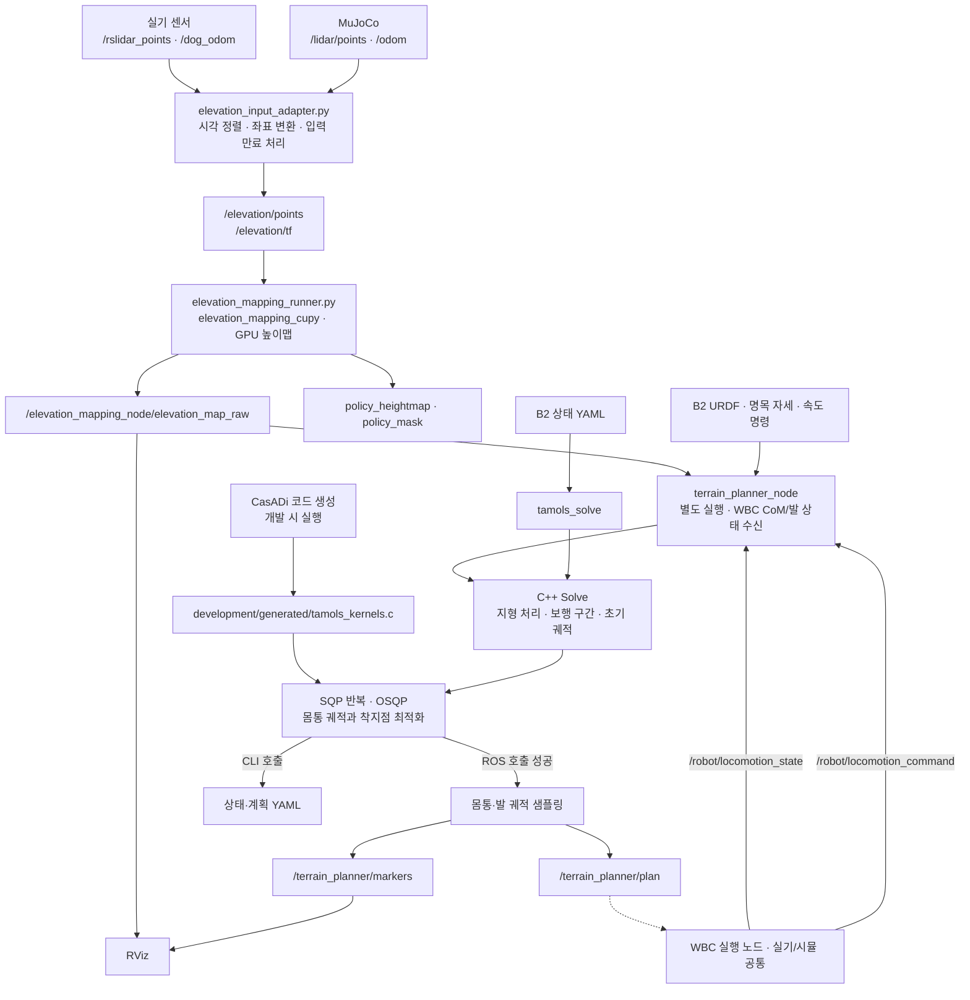

# B2 지형 계획 설계·운영 상세 노트

이 문서는 `README.md`에서 분리한 상세 설계·운영 내용을 한곳에 모은 참고 문서다.
README는 패키지 개요·의존성·빌드·사용 명령만 담고, 알고리즘 근거·구현 경계·검증
기록·진단 토픽·맵 런타임 절차·평지 검증 같은 자세한 내용은 모두 여기에 둔다.

맵 실행기는 환경변수로 설정하는 단일 스크립트 `scripts/run_elevation.sh`다. 과거 문서에
나오던 플래그는 다음 환경변수에 대응한다(자세한 내용은 README의 환경변수 표 참고).

| 과거 플래그 | 환경변수 |
| --- | --- |
| (sim 기본) / `--mode real` | `MODE=sim`(기본) / `MODE=real` |
| `--rviz` | `RVIZ=1` |
| `--start-sim` | `START_SIM=1` |
| `--interface <NIC>` | `INTERFACE=<NIC>` |
| `--config <YAML>` | `INPUT_CONFIG=<YAML>` |

## 목차

- [계획기·런타임 설계](#계획기런타임-설계) — 맵 발행, TAMOLS 지형 처리·가중치, 착지 후보,
  support patch, 워크플로우, ROS 연결 구현 범위, 명령 확정, 높이 기준 계약, 진단 토픽, 검증 기록
- [맵 입력·런타임 절차](#맵-입력런타임-절차) — 실기/시뮬 입력 구성, 유선 LAN 실기 맵, 입력 계약
- [평면 지도 TAMOLS 검증](#평면-지도-tamols-검증) — 평지 모드 동작, 재현 도구, 검증 기록

---

## 계획기·런타임 설계

B2 맵은 `b2_terrain_planner/config/b2_terrain.yaml`의
`mapping.publishers.elevation_map_raw.publish_on_update: true`로 융합 직후 발행합니다.
고정 20Hz 타이머를 기다리거나 같은 지도를 반복 직렬화하지 않고, 처리 가능한 센서
입력 속도를 따릅니다. 입력 adapter와 맵 runner의 대기 점군은 각각 최신 한 개입니다.
adapter는 점군 수신 및 필요한 odom 도착 시 바로 처리하고, runner도 수신 시 바로
융합합니다. 기존 20ms/10ms 타이머는 TF·odom 대기 중 재시도용으로 유지합니다.
원본 측정 시각, 정확한 시각의 TF 조회, odom 보간·불연속 reset, 초기화 규칙과 기존
시간 조건은 유지합니다. 맵과 TAMOLS 계산을 서로 동기화하거나 새 발행 거부 조건을
추가하지 않습니다. 점군이 끊기면 새 지도도 없으며 planner의 기존 계획 처리가 적용됩니다.

CuPy 패키지는 점군 수신·지도 발행 depth 1, raw 3개 층의 묶음 GPU 복사를 사용합니다.
변경 후 두 패키지를 함께 빌드하고 맵 노드를 재시작합니다.
검증은 기존 ROS·CuPy Python 환경에서
`python b2_terrain_planner/development/tests/map_update_delivery_test.py b2_terrain_planner`
및 `initializer_gpu_test.py`를 같은 인자로 실행합니다. GPU 테스트는 별도 ROS 도메인으로
실행하여 사용 중인 시뮬레이션과 분리합니다.

WBC와 함께 사용하는 통합 실행은 `b2_deploy_ws/scripts/run_laptop.sh`가 담당한다.
GUI·RViz·지도·TAMOLS·시각화 TF를 함께 실행하고, 지도 입력은 `/kf/odom`으로 맞춘다.
로봇 측은 `b2_deploy_ws/scripts/run_robot.sh`로 실행한다(개발 PC 기본 MuJoCo).
자세한 사용법은 [두 역할 실행 문서](../../b2_deploy_ws/docs/two_process_runtime.md)를 따른다.
통합 설정에서는 로봇이 제어권을 검증해 발행한 `/robot/locomotion_command`
(`geometry_msgs/TwistStamped`)를 속도 목표로 사용한다. `base_heading`의 수평 전후/좌우
속도와 yaw 속도이며, 기본 0.25초 동안 새 명령이 없으면 0으로 처리한다.
`/terrain_planner_node/effective_command`에서 실제 계획 입력에 사용하는 값을 확인할 수 있다.
단독 실행의 고정 `command` 파라미터는 `command_topic`이 비어 있을 때만 사용한다.
통합 WBC 설정은 전역 지면 오프셋과 작은 접촉 기억 패치를 planner 입력에 적용한다.
명령 전달 및 국소 지도 보정과 전체 폐루프 보행 성공은 별도로 검증한다.
`/terrain_planner/elevation_map_corrected`는 실제 SQP 입력의 z 보정·접촉발 패치 적용 후
지도를 최대 10 Hz로 발행한다(reliable/transient-local, 마지막 1개). 원본 지도 시각과
좌표를 유지하며 `elevation`의 미관측 셀은 NaN이다. solve 완료 시 계산 지도
`h`, `h_s1`, `h_s2`와 원본 마스크 `observed`를 함께 발행한다. 새 입력이 없으면 마지막 지도를 유지한다.
비평지 sim `--tamols --rviz`의 기본 표시는 `RawElevationMap`이며,
`CorrectedElevationMap`을 별도로 켜서 실제 SQP 입력과 비교한다.
`map_datum_reanchor.enabled: true`, `support_patch.enabled: true`로 planner 입력에만
전역 지면 오프셋과 반폭 0.025m 접촉 패치를 적용한다. CuPy raw 셀은 바꾸지 않는다.
raw 진단에서 datum을 끄더라도 지도는 지면, 발 위치는 중심이라는 기준은 유지한다. CuPy 시작 초기화는
`use_initializer_at_start: true`로 켜 로봇 아래 미관측 영역만 한 번 채운다. odom 추정기와 CuPy 내부 융합 설정은 바꾸지 않는다.
sim `--tamols`는 원본·보정 지도와 발 상태·odom 전체 메시지를 deploy의
`runtime_logs/map_history_*` rosbag으로 기록한다. 원본 지도 보정이나 보행 개선 자체를 뜻하지 않는다.
아래의 GT/실기 센서 전용 맵 실행은 개별 진단용 경로다.

평지 알고리즘 검증은 두 실행기에 모두 `--flat`을 붙인다. 별도 평면 MuJoCo XML과
기존 LiDAR/CuPy 지도를 사용하고, 입력 GridMap의 구조를 유지한 채 높이·분산·유효성만
평탄화한다. 평면 높이는 확인 지지발의 지면 높이를 변화율 제한으로 추적해 odometry 드리프트를 반영한다.
초기화와 후속 갱신 모두 확인 지지발 중심에서 `foot_radius`를 뺀 지면 높이를 사용한다. TAMOLS와 RViz는 `/terrain_planner/elevation_map_flat`을 받는다.
현재 지지발은 추정 위치를 그대로 사용하며 지도와 5mm 이상 높이가 달라도 입력을 거부하지 않는다.
현재 발·확정 착지점의 지도 조회를 재계획 조건으로 요구하지 않는다. 새 착지점의 지도 조회와
SQP의 지형 비용·GIAC·마찰·도달 길이 제약은 유지한다.
최적화 뒤 별도로 수행하던 지도 높이·관절 IK 검사는 제거했다.
이 변경은 높이 오차를 보정하거나 계산 성공을 보장하는 기능이 아니다. 계산 시간 제한과
접촉·궤적 연결을 포함한 연속 보행 검증은 별도다.
실행 순서, 재현 명령과 확인된 한계는 [평면 지도 TAMOLS 검증](#평면-지도-tamols-검증)를 따른다.

B2 센서 또는 MuJoCo의 점군·odometry로 GPU 높이맵을 만들고, C++ TAMOLS 계획기로
몸통 CoM 궤적과 착지점을 계산한다. ROS 노드는 계획과 RViz 마커를 발행하고,
`tamols_solve`는 B2 상태 YAML을 읽어 독립적으로 계획을 계산한다.

이 저장소의 범위는 **센서 입력 → 지형 맵 → 상위 계획 → ROS 출력**이다.
WBC·모터 제어·MuJoCo 실행파일은 별도 `b2_deploy_ws`가 소유한다.
이 저장소에는 pRbLibrary 소스나 서브모듈이 없으며, B2 URDF 복제본만 포함한다.

### 시작 시 CuPy 발밑 초기화

평지에서 출발한다는 전제로 `use_initializer_at_start: true`를 기본으로 사용한다.
`initialize_patch_length: 2.4`, `initialize_patch_width: 1.6`로 몸통 중심·yaw에 맞춘
2.4×1.6m 사각형의 미관측 셀만 한 번 채운다. 발 TF의 중심 높이나 고정 0을 쓰지 않고,
같은 시각의 LiDAR 점군에서 주변 바닥 높이 중앙값을 측정해 초기 평면으로 사용한다.

CuPy 내부 배열은 행=Y, 열=X이다. runner는 월드 X/Y에서 지도 중심을 빼고 셀 좌표로
변환한 뒤 Y/X 순서로 초기화기에 전달한다. X/Y를 그대로 넘기면 비정방형 패치의
앞뒤·좌우 길이가 뒤집히고 yaw·중심 위치도 어긋난다. `initializer_gpu_test.py`는
배열의 열/행을 월드 X/Y로 복원해 회전된 몸통 기준 범위와 양쪽 끝의 채움을 검사한다.
GPU 회귀에서 수정 전 범위 실패와 수정 후 통과를 확인했으며, 관측 높이·장애물 보존·
후속 LiDAR 융합·일회성 및 clear 후 재초기화 검사도 통과했다. 실제 보행 검증은 별도다.

runner는 CuPy의 기존 linear 초기화기를 별도 버퍼에서 실행한다. dilation 없이 지정한
사각형 안만 채우며 기존 관측 셀·장애물 높이는 보존한다. TF 또는 바닥 관측을 기다릴
때에도 LiDAR 융합은 계속한다. 초기화 후 셀은 일반 지도 셀처럼 센서 관측으로 갱신된다.
`Ground initializer complete: height=..., patch=2.40x1.60 m, filled=N cells` 로그로 확인한다.
map clear 후에는 다시 한 번 초기화하며, 보행·접촉 전환마다 평면을 재생성하지 않는다.
초기화 셀은 CuPy 원본 지도에 들어가므로 raw·보정 지도와 rosbag에서 확인할 수 있다.
설정은 `b2_terrain_planner/config/b2_terrain.yaml`의 `mapping`에 있으며
`use_initializer_at_start: false`로 끌 수 있다.
설치 설정 반영 후 맵 노드를 포함해 실행을 재시작한다. 비평지 출발에는 이 가정을 사용하지 않는다.

### TAMOLS 지형 처리와 착지 후보

기본 `terrain.pipeline_enabled: true`는 [TAMOLS 논문](https://arxiv.org/abs/2206.14049)의
지형 처리(IV), 경계 비용(V-B), 단계 초기화(V-D)를 따른다. 원본 관측 지도는 보존하고,
연결된 미관측 영역을 경계의 최소 높이로 채운 계산 복사본에 median을 적용해 `h`를 만든다.
약한 Gaussian의 `h_s1`과 mask dilation·강한 Gaussian의 가상 바닥 `h_s2`를 별도로 둔다.
5점 중앙차분 기반 경계 비용은 `h`와 `h_s1` 양쪽의 기울기를 사용한다. 이전의
"필터 주변에 미관측 셀이 하나라도 있으면 경계 비용 0" 처리는 기본 경로에서 사용하지 않는다.

후보 보정에는 원본 미관측 마스크, 양의 곡률, `h_s2`와의 높이 차 비용을 포함한다.
몸통은 각 hip 투영점에서 가상 바닥과의 상대 높이 비용을 사용한다. 새 착지 슬롯에서
가상 바닥 최적화→coarse 착지점 주변 0.4m 폭 후보 보정→실제 지형 최적화를 수행한다.
같은 슬롯 재계획은 이전 해를 재사용한다. 기존 확정 착지점은 그대로 유지한다.
지도 처리·초기화는 기존 solve 예산에 포함하며 기본 100ms 중 준비 단계에 최대 25%를
배정한다. 준비 단계 실패·시간 부족 시 직접 초기화로 실제 지형 SQP를 계속한다.
별도 발행 거부 조건은 추가하지 않는다. 필터 폭과 가중치는 B2 튜닝값이며 논문의
고정 수치가 아니다. 돌 중앙은 비용이 낮은 후보로 유도하며 강제로 지정하지 않는다.

설정은 `b2_terrain_planner/config/b2_terrain.yaml`의 `planner.common.terrain.*`에 둔다.
`median_iterations`, `smoothing_sigma`, `virtual_floor_sigma`, `virtual_floor_radius`는
계산 지도 형상을, `occlusion_weight`, `curvature_weight`, `virtual_height_weight`는
후보 선호를, `body_alignment_weight`는 몸통 정렬을 조절한다.
`graduated_initialization`, `graduated_budget_fraction`은 준비 단계를 설정한다.
독립 CLI는 같은 이름을 `terrain_settings`에 받는다. 비교 진단 시
`pipeline_enabled: false`로 기존 관측 전용 처리를 선택할 수 있다.

`IsQueryable`은 처리 높이 조회 가능 여부다. 관측 여부는 원본 `valid` 또는
`Sample.occlusion`으로 확인한다. 보간 셀은 `observed=0`이며 센서 관측으로 취급하지 않는다.
보정 GridMap의 `h`, `h_s1`, `h_s2`, `observed`와 solve 로그의
`terrain_processing_seconds`, `terrain_initialization_seconds`, `terrain_initialization_status`로
계산 입력·비용·준비 시간의 적용을 확인한다. 설치 후 실행기를 재시작해야 한다.
합성 돌 후보·미관측 마스크·Jacobian·초기화/재사용/예산 fallback은
`terrain_pipeline_test`로 검증한다. 이 테스트는 실제 parkour 보행 성공 검증을 대체하지 않는다.

검증 결과: CPU 회귀 11개와 ROS flat-map·planner-retry 시험 2개는 통과했다.
기록된 parkour 지도에서는 문제 착지점의 경계 항이 0에서 양수로 복구되고 후보가
안쪽으로 약 4.7cm 이동했다. headless parkour 실행(전진 명령 0.25m/s)은 122회 계산 중
110회 성공·92회 발행, 지형 처리 중앙값 2.6ms·전체 계산 중앙값 10.5ms였다.
11회는 100ms를 초과했고 최대 110.7ms였다. 돌 구간에서 자세를 잃고 감쇠 모드로
전환했으므로 통과한 보행 시험이 아니다. 목표/실제 착지 차이와 위치 추정 오차가
약 7~8cm인 사례도 남아 있다. 평지 통합 시험은 원본 지도 미발행으로 계산 전 중단됐다.
지형 비용 개선과 지도·추정·실제 착지 정합 및 폐루프 보행 안정성을 분리해 확인해야 한다.

이 반영은 지형·착지 관련 누락을 보완한다. 원문의 모든 비용·모델을 동일하게
구현했다는 뜻은 아니다. 몸통 추종·평활 비용과 각운동량 모델의 차이, 외력 추정 입력,
무릎 오프셋 기반 스윙 모델은 별도 범위이며 이번 변경에 포함하지 않는다.

### TAMOLS 목적함수 가중치 기준

[TAMOLS 논문 Table I](https://arxiv.org/html/2206.14049v2#S5.T1)에 맞춰
발 충돌 회피는 `0.001`, 이전 착지점 유지는 `0.01`, 수평 속도 추종은 `2`를 사용한다.
숫자는 잔차를 제곱한 뒤 목적함수에 곱하는 계수다. 이전 착지점 유지 값은
C++ 기본값·ROS 기본값·`planner.common.previous_foothold_weight`를 함께 맞춘다.
충돌 계수는 `terrain.h`, 수평 속도 계수는 커널 생성기에서 관리한다.
설정과 커널을 빌드·설치한 뒤 planner를 재시작해야 반영된다.

지면 높이 `10000`, nominal 자세 `7`, 경계 회피 `3`, 안정성 여유 `0.007`,
몸통 지형 정렬 기본 계수 `100`도 논문 표와 같다. 다만 전체 목적함수가 동일한 것은 아니다.
현재 이전 착지점 유지는 XY만 평가하고, 회전 추종은 각운동량 대신 yaw 속도,
부드러움은 각운동량 변화율 대신 각가속도를 사용한다. ROS 노드의 시간 가중은 구간 길이/7이며,
논문의 구간 길이/6과 다르다. 선가속도·뒤쪽 착지·계획 연결 비용과 후보 보정의
B2 튜닝값은 유지한다. 수평 pitch/roll 선호는 지형 정렬 활성 시 꺼진다.
이 변경은 논문 계수의 기준선 정렬이며 충돌 회피나 실제 보행 성공을 보장하지 않는다.

### 발 주변 셀과 최종 착지점의 거리 비용

`planner.common.terrain.foot_separation_*`는 기존 거리 비용에 더하는 B2 좌우 간격 비용이다.
`weight: 0.1`, `distance_y: 0.08`, `scale: 0.01`을 사용하며,
가중치 0은 비활성화한다. C++ 기본 가중치는 0이고 ROS·CLI 설정에서 명시적으로 켠다.
solve 입력 몸통 yaw로 발 사이 XY를 회전해 `dy`를 구하고,
`d = sqrt(dy² + 1e-12)`에 대해 `C = weight × exp((distance_y − d) / scale)`을 더한다.
발 중심 Y 간격 8cm에서 비용은 weight이며 안쪽으로 1cm 접근할 때마다 e배 증가한다.
X 간격은 비용과 기울기에 영향을 주지 않는다. Y 20cm에서 약 6.1e-7,
40cm에서 약 1.3e-15로 작아 일반적인 지지 폭을 계속 넓히지 않는다.
발 지름은 기본 6.4cm이므로 중심 간 5cm를 충돌 예방 경계로 쓰지 않는다.

비용 대상은 앞발 FL/FR와 뒷발 RL/RR 쌍이다. 같은 쪽 앞뒤 발은 이 비용에서 제외한다.
초기 후보 셀·비격자 nominal·이전 후보 비교는 짝 발의 현재 접촉 위치를 사용한다.
연속 SQP는 현재/미래 착지 조합에서 같은 좌우 쌍에 같은 함수를 적용한다.
후보의 `separation_supports`는 좌우 비용 대상이며, 전체 지지발의 `occupied`와 분리한다.
셀 중심을 비용장에 대입하되 연속 좌표를 셀로 반올림하지 않는다. 해석 미분을
Gauss–Newton 목적함수에 연결하며, 잔차 지수 10 초과는 접선으로 연장해 overflow를 피한다.
기존 점유 3×3 제외·방사형 거리 비용·계산 예산·대체 초기화는 유지한다.
추가 강제 제약·발행 거부는 없으며, 이 비용만으로 스윙 링크 충돌이나 보행 성공을 보장하지 않는다.

`lateral_separation_test`는 거리장 미분·몸통 회전 불변성·급증 경계·먼 거리 감쇠,
X 무관성, 후보 셀과 SQP의 동일 비용, 점유 전용 발의 비용 제외 및 회전 명령 착지점을 검증한다.
관련 CTest 7개를 통과했다. MuJoCo 시험은 접촉 발 추정 높이로 맞춘 시험용 평탄 지도에서
좌회전·우회전 각각 7초를 완료했다. 회전 중 실제 좌우 간격 중앙값은 앞 38.2cm·뒤 37.9cm,
계획 간격은 앞 38.8cm·뒤 38.5cm였다. 229회 solve 중 199회 계획을 발행했다.
원래 Arena 장애물의 동일 실패 재현이나 모든 충돌 방지는 별도 검증이 필요하다.

### 초기 착지 후보의 지지발 점유 제외

초기 후보 검색에서는 자기 발을 제외한 현재 접촉 발의 셀과 주변 1칸을 제외한다.
대각선을 포함한 3×3 셀이며, 5cm 지도에서는 셀 경계 기준 15×15cm 영역이다.
점유 셀은 지도 origin(셀 중심)에 대한 최근접 셀로 정하고, 셀 중심이 아닌 nominal에도
같은 규칙을 적용한다. 접촉 추정 입력이 있으면 이를 사용하고 없으면 현재 gait 접촉을 따른다.
일반·가상 바닥·도달성 재탐색·다른 지지면 후보와 이전 초기값 재사용에 동일하게 적용한다.
확정 착지점은 유지한다. 지도 높이·관측 표시나 최종 SQP 제약은 바꾸지 않는다.

점유 제외로 초기 후보가 모두 없어지면 해당 발의 현재 XYZ로 초기화해 기존 SQP를 계속한다.
후보 보정·대체 후보 탐색은 기존 fallback을 따른다. 지도 미관측·범위 오류의 기존 처리는 유지한다.
이 방식은 겹친 초기 후보를 줄이며, 이후 연속 최적화가 다시 접근하는 것까지 보장하지 않는다.
후보의 거리 비용은 직전 발 위치가 아니라 몸통·명령으로 만든 nominal을 기준으로 한다.
nominal ±0.30m 검색은 한 걸음의 이동량 제한이 아니므로, 지형 경계 비용이 더 작은
먼 돌을 선택해 횡보폭이 커질 수 있다. 후보는 nominal과 지도 셀 중심을 비교한다.
`terrain_validity_test`는 3×3 제외·외곽 보존·비격자 후보를,
`terrain_reuse_test`는 후보 소진 시 SQP 진입과 기존 재사용 동작을 검증한다.

### 접촉 발의 작은 영역과 높이 기억

`b2_terrain.yaml`의 `planner.wbc`에서 `support_patch.enabled: true`이면,
`contact_confirmed && contact_estimated`인 발 주변 셀을 `발 중심 Z − foot_radius`인 지면 높이로 기억한다.
기본 `support_patch.half_width: 0.025`는 X/Y 각 방향 2.5 cm(전체 5×5 cm) 영역이다.
필터·미분·보간을 위해 영역을 자동으로 넓히지 않는다. 해당 영역 안의 셀 중심만
갱신하므로 실제 표시 경계는 지도 해상도에 따른다. 겹치면 가장 가까운 접촉 발을 따른다.

기억한 셀은 발을 들어도 유지하며, 새 원본 지도가 도착해도 지우지 않는다.
같은 셀에 다시 접촉하면 최신 발 중심에서 반경을 뺀 지면 높이로 갱신한다.
각 기억은 접촉을 기록한 당시 셀 중심의 지도 좌표와 관측 시각을 보존한다. 지도 이동 시
그 원래 좌표에서 최근접 셀을 찾으며, 재배치된 셀 중심으로 원래 좌표를 덮어쓰지 않는다.
따라서 비정수 셀 이동에서도 축별 반 셀 이내의 표시 양자화만 생기고 오차가 누적되지 않는다.
재배치가 겹치면 최신 관측을 유지하고, 지도 이동은 기억의 수명을 연장하지 않는다.
로컬 지도 밖의 기억은 버리며 지도 frame·해상도 변경, ROS 시각 역행, 노드 재시작 시
기억을 초기화한다. 기억은 현재 로컬 지도 크기로 제한하며 파일에서 복원하지 않는다.
CuPy GridMap의 XY 중심도 연속 로봇 TF가 아닌 내부 격자 중심을 발행해야 한다.
정수 셀로 이동하는 내부 배열에 연속 TF 중심을 붙이면 정적 지형 좌표가 흔들린다.

발 링크 원점은 구 중심이다. 접촉 기록 때 반경을 한 번 빼고 기억을 재적용할 때는 빼지 않는다.
보정 셀의 유효성은 1, 분산은 0이다. 원본 관측 지도에는 쓰지 않고, datum 오프셋을 적용한
계획 입력 복사본 위에 접촉 기억을 덧씌운다. 따라서 발을 뗀 뒤에도 같은 셀이
TAMOLS와 RViz의 `CorrectedElevationMap`에 남는다. 그 밖의 관측 지형·미관측 영역은 보존한다.
이는 시간에 따른 odom 드리프트나 원점 재설정을 추정해 보상하는 기능은 아니다.

단독 ROS 실행은 기본 OFF이며 통합 설정도 `support_patch.enabled: false`로 끌 수 있다.
계획 입력 갱신이 멈추면 보정 지도 표시는 마지막 입력을 유지한다.
검증은 좁은 영역, 이륙 후 보존, 재착지, 반복 비정수 셀 이동·수명·초기화에 관한 것이며
최적화 성공률이나 폐루프 보행 성공을 보장하지 않는다.

### 전체 워크플로우



맵 launch는 입력 어댑터·맵·선택적 RViz를 실행한다. `terrain_planner_node`는 별도로
실행해야 한다. 점선은 외부 연동 경계이며, 이 저장소만으로 WBC 추종 완료를 보장하지 않는다.

계획기는 trot의 지지 구간을 구성하고, 이전 계획이 호환되면 warm start를 사용한다.
생성 C 커널로 비용·GIAC·마찰·기구학 제약과 미분을 평가하며, C++에서 QP 구성,
등식 처리, 비선형 제약 보정과 line search를 수행한다. OSQP는 각 QP를 푼다.
SQP가 실행 가능하다고 판정한 계획을 별도 지도·IK 사후 검사 없이 출력한다.

### 저장소 구조

```text
b2_terrain_planning/
├── b2_terrain_planner/
│   ├── src/, include/    # SQP, 지형, RBDL 모델, CLI, ROS 노드
│   ├── development/
│   │   ├── codegen/    # CasADi 수식과 C 미분 커널 생성기
│   │   ├── generated/  # 일반 빌드에서 사용하는 생성 C 코드
│   │   └── tests/      # 계약·회귀·ROS 통합 검증 소스
│   ├── model/           # B2 URDF와 출처
│   ├── msg/             # LocomotionPlan·LocomotionState 메시지
│   ├── config/          # 센서·맵·RViz·B2 상태 설정
│   └── scripts/, launch/# 실기·시뮬 맵 실행
├── AGENTS.md            # 이 저장소의 단일 작업 규칙
└── docs/                # 맵 운영 절차와 외부 소스 기준
```

기존 누적 실험 기록과 Python 참조 구현은 제거했다. 현재 계약 시험과 평지 재현 도구는
`b2_terrain_planner/development/tests/`에 유지하고, 변경 이력은 Git에서 관리한다.
`development/`에는 생성기·빌드에 필요한 생성 소스·검증 소스를 모으며 임시 파일을 보관하지 않는다.
작업 규칙은 저장소 루트의 `AGENTS.md` 하나에서 관리한다.
ROS 빌드·설치·로그는 워크스페이스의 `build/`, `install/`, `log/`를 사용한다.
CPU 단독 시험은 `/tmp`에 빌드한다. 저장소 내부에 별도 빌드·설치 경로를 만들지 않는다.

### 설정

설정 원본은 `b2_terrain_planner/config/b2_terrain.yaml` 하나로 관리한다.

| 필드 | 용도 |
|---|---|
| `input.sim`, `input.real`, `input.wbc` | 입력 점군·odometry·센서 장착값 |
| `mapping` | CuPy 맵 해상도·초기화·보호 영역·발행 설정 |
| `planner.common` | WBC·평지 계획기의 공통 파라미터 |
| `planner.wbc`, `planner.flat` | 공통값에 덧씌우는 모드별 차이 |
| `example` | 독립 CLI의 B2 상태·속도 명령 예제 |

빌드할 때 `scripts/generate_config.py`가 빌드 경로의 `config/` 아래에 기존 이름의
ROS 파라미터 YAML과 CLI 예제 YAML 7개를 생성하고 설치 경로의 `config/`에 배치한다.
기존 launch와 `b2_deploy_ws` 실행기는 설치된 파일명을 그대로 사용한다.
생성 파일을 직접 수정하지 않고 원본을 수정한 뒤 사용하는 설치 경로를 다시 빌드한다.
원본 변경 시 CMake가 설정을 재생성하며, 중복 키나 누락된 모드는 빌드 설정 단계에서 거부한다.
RViz 화면 설정은 기존 `.rviz` 파일에서 관리한다.

### 빌드

CPU 계획기에는 CMake, C++17, Eigen3, yaml-cpp, LAPACK(LP64), pkg-config, tinyxml2,
RBDL 및 URDF reader, **OSQP 0.6.x double-precision C API(PROFILING 포함)**가 필요하다.
설정 파일 생성에는 Python 3와 PyYAML(`python3-yaml`)이 필요하다.
기존 환경의 기준은 OSQP 0.6.3, RBDL 3.3.1, tinyxml2 9.0.0이다.
OSQP 1.x는 C API가 달라 직접 호환되지 않는다.

```bash
# 저장소 루트에서 CPU 계획기만 빌드
cmake -S b2_terrain_planner -B /tmp/b2-terrain-cpu-build \
  -DB2_TERRAIN_STANDALONE=ON -DCMAKE_BUILD_TYPE=Release -DPython3_EXECUTABLE=/usr/bin/python3
cmake --build /tmp/b2-terrain-cpu-build -j2
```

ROS 맵·상위 계획은 같은 워크스페이스에서 `colcon`으로 빌드한다.
`b2_deploy_ws/scripts/build.sh --elevation` 또는 `--tamols`도 같은 경로로 직접
`colcon`을 호출한다. `--all`은 제어기·맵 패키지를 함께 빌드한 뒤 GUI를 빌드한다.
맵·제어기·TAMOLS 실행기는 모두 `~/ros2_ws/install`을 사용한다.

```bash
cd ~/ros2_ws
source /opt/ros/humble/setup.bash
colcon build --base-paths src \
  --packages-up-to b2_terrain_planner elevation_map_msgs elevation_mapping_cupy ros2_numpy \
  --executor sequential \
  --cmake-args -DCMAKE_BUILD_TYPE=Release -DBUILD_TESTING=ON -DPython3_EXECUTABLE=/usr/bin/python3
ctest --test-dir build/b2_terrain_planner --output-on-failure
```

CPU 빌드와 실행에는 ROS·GPU·CasADi·IPOPT가 필요하지 않다.
OSQP 위치는 CMake의 `OSQP_INCLUDE_DIR`, `OSQP_LIBRARY`,
RBDL 위치는 `RBDL_DIR` 또는 `CUSTOM_RBDL_PATH`로 지정할 수 있다.

ROS 빌드는 같은 워크스페이스의 `elevation_mapping_cupy`와 `ros2_numpy`도 사용한다.
맵 실행에는 NVIDIA GPU·CUDA·CuPy와 해당 Python 환경이 필요하다.
맵 실행은 기본으로 워크스페이스 설치본을 찾으며, 별도 설치본을 쓸 때는
`ELEVATION_PREFIX=<설치 경로>`를 지정한다. 통합 실행기는 자신이 사용하는 install로 고정한다.

### B2 YAML 계획 실행

```bash
/tmp/b2-terrain-cpu-build/tamols_solve --input b2_terrain_planner/config/b2_terrain.yaml
/tmp/b2-terrain-cpu-build/tamols_solve --speed 0.1 --fast-replanning
/tmp/b2-terrain-cpu-build/tamols_solve --help
```

`model_state`는 base 위치·quaternion, 월드 선속도, 몸통 각속도, 관절 위치·속도를 받는다.
RBDL로 FK·CoM·질량·CoM 기준 관성을 계산한다. 관절 순서는 FL/FR/RL/RR × hip/thigh/calf다.
`model_path`는 입력 YAML 기준 상대 경로 또는 절대 경로이며, 생략하면 포함된 B2 URDF를 쓴다.
`command`는 몸통 기준 `[vx, vy, yaw_rate]`다. `gait_time`, `nominal`, `fixed`도 입력할 수 있다.
통합 설정은 `example` 필드를 읽으며, 기존 개별 입력 YAML도 계속 지원한다.

정적 지형은 `terrain`의 `frame`, `resolution`, `origin`, `heights`, `variance`, `valid`로
전달한다. 배열은 행=Y, 열=X 증가 방향이며, `origin`은 최소 모서리 좌표다.
입력 `frame`과 지형 `frame`이 일치해야 한다. `terrain_settings`에서 평활 폭·
접촉 오차·지형 비용을 조정할 수 있다. 필드와 기본값은
[terrain.h](../b2_terrain_planner/include/b2_terrain_planner/terrain.h)를 따른다.
셀의 `variance`는 메타데이터로 보존하며 값에 따라 지형을 제외하지 않는다.
유효 표시와 유한한 관측 높이로 셀을 사용하며, 기존 `max_variance` 설정은 제거됐다.

출력은 상태·시간·제약 위반·모델 정보이며, 성공할 때만 착지점과 구간별 다항식 계수가
포함된다. 좌표 순서는 CoM XYZ, yaw/pitch/roll(ZYX)이고 계수의 시간 단위는 실제 초다.
`converged`, `feasible_stalled`, `feasible_realtime_step`은 각각 수치 수렴, 가능한 해에서의
정체, warm start 이후 제한 반복 갱신을 구분한다. `--time-limit`은 계산 예산이다.
`--profile`은 시간·QP 상태를 추가 출력한다.

`--warm-start <이전 출력.yaml>`은 현재 B2 상태와 함께 이전 계획을 넘긴다.
모델·프레임·지형 사용 여부·보행 주기의 호환성을 확인한 뒤 사용한다. 지도 영역 이동이나
관측 갱신만으로 초기 궤적을 폐기하지 않으며, 이전 착지점은 현재 지도에서 다시 검사한다.
범위·높이·도달성에 맞지 않는 초기 목표는 새 후보를 사용하며, 기존 SQP 제약으로 계산한다.
`--fast-replanning`은 QP 재사용·구조 등식·LAPACK 등을 묶은 CLI 프리셋이다.
ROS 노드의 QP 정규화·반복 수·허용 오차와는 값이 다르다.

합성 모델, 제약 해제, 상세 line-search 추적, 이상 추종 재생 CLI는 제공하지 않는다.
이전 출력의 제약 해제 표시가 참이면 warm start 입력을 거부한다.

### 맵과 ROS 계획 실행

```bash
# 이미 실행 중인 MuJoCo 센서에 맵과 RViz 연결
RVIZ=1 ./b2_terrain_planner/scripts/run_elevation.sh

# 실기 센서에 맵과 RViz 연결: NIC 이름은 실제 환경에 맞춘다
MODE=real INTERFACE=enp3s0 RVIZ=1 ./b2_terrain_planner/scripts/run_elevation.sh
```

시각 동기화·DDS·장착 TF·입력 만료 처리는
[맵 입력·런타임 절차](#맵-입력런타임-절차)를 따른다.

계획 노드는 별도 터미널에서 실행한다. 시뮬레이션과 실기 모두 WBC 실행 노드의
`/robot/locomotion_state`를 구독한다. WBC task를 실행해 추정 상태가 유효해져야 계획을 시작한다.
맵 입력 odometry도 `/kf/odom`으로 설정해야 한다. 기본 맵 시연 설정의 `/odom` 또는
`/dog_odom`은 KF 좌표와 자동으로 같아지지 않는다.
아래 예시는 맵의 `elevation_odom`이 상태의 `odom`과 같은 원점·방향으로 설정된 경우다.
노드 내부에서 TF 변환하지 않으며 `frame`은 맵 프레임, `state_frame`은 상태 프레임이다.

```bash
source /opt/ros/humble/setup.bash
source ~/ros2_ws/install/local_setup.bash
ros2 run b2_terrain_planner terrain_planner_node --ros-args \
  -p state_topic:=/robot/locomotion_state -p state_frame:=odom -p frame:=elevation_odom
```

발행 계획·마커는 상태 메시지의 `header.frame_id`를 사용한다.
RViz의 Fixed Frame과 연결되는 TF도 같은 좌표 계약에 맞춰야 한다.

| ROS 노드 설정 | 기본값 |
|---|---|
| `state_topic`, `state_frame` | `/robot/locomotion_state`, `odom` |
| `state_max_age`, `map_max_age` | 0.25 s, 1.0 s |
| `map_topic` | `/elevation_mapping_node/elevation_map_raw` |
| `frame` | `odom` — 입력 맵은 기본 `elevation_odom`이므로 실행 시 확인 |
| `command` | `[0.1, 0.0, 0.0]` |
| `plan_rate_hz`, `time_limit` | 10 Hz, 0.1 s |
| `sample_dt`, `swing_height` | 0.02 s, 0.10 m |
| `require_map`, `publish_markers` | true, true |
| `plan_topic`, `marker_topic` | `/terrain_planner/plan`, `/terrain_planner/markers` |

### 현재 ROS 연결의 구현 범위

- `LocomotionState`의 전신 CoM 위치·속도와 네 발 위치를 최적화 초기 상태로 사용한다.
  WBC 실행 노드는 실기에서도 얻는 IMU·관절 q/dq·모터 토크 추정값과 KF/운동학만 사용한다.
  simulator GT base·발·접촉·GRF는 이 메시지의 입력이 아니다.
- ROS 계획기의 중립 발 XY 배치는 명목 자세에서 계산한 CoM 기준 발 오프셋의
  평균 XY를 빼서 중심을 맞춘다. 이 기준으로 새 착지점을 최적화하고 지형 높이와
  스윙 궤적을 계산한다. 현재 측정 발 위치, 확정된 착지점, 명목 발 Z와 운동학 모델은
  유지한다. 변경 적용에는 `terrain_planner_node` 재시작이 필요하다.
- 몸통 자세와 world 각속도를 받아 Euler 변화율로 변환한다. 명목 base→CoM 변환은 제거했다.
  질량·관성·도달성 모델의 명목 관절 근사는 여전히 남아 있다.
- 네 발 속도와 `contact_estimated`, `contact_confirmed`를 전달한다. WBC가 착지 확인에 따라
  보행 시간을 정지·재개하며 TAMOLS는 같은 `gait_time`으로 고정 trot 순서를 계획한다.
  보행 대기 지지는 WBC stance를 나타내는 `contact_confirmed`만으로 판정한다.
  stance 이후 `contact_estimated`가 OFF여도 지지를 취소하지 않으며, 추정 접촉은
  접촉 주변 지도 보정에 별도로 사용한다. 현재 지지발의 높이를 지도와 강제로 일치시키지 않는다.
  현재 지지발은 측정 XYZ에 지지가 있다고 가정하며, 스윙발도 현재 XY 아래 지도 관측을
  요구하지 않는다. 현재 발 아래 미관측으로 SQP 시작을 거부하지 않는다.
  몸통 최적화는 각 구간의 실제 지지발 조합과 위치에 맞춰 대각선 2발·3발·4발
  제약을 선택한다. 착지 시차로 생기는 3발 지지는 네 조합의 삼각형으로 계산하며,
  미착지 발을 대각선 지지로 대신 사용하지 않는다. 3발·4발 구간에는 지지 여유
  변수를 사용한다. 이륙 순서는 trot을 유지하고 착지점은 해당 발의 이륙 시 확정한다.
- 메시지 필드명은 유지한다. `base_pose.position`과 `base_twist.linear`는 전신 CoM,
  `base_pose.orientation`은 몸통 자세, `base_twist.angular`는 roll/pitch/yaw 변화율이다.
  `b2_deploy` bridge가 각속도로 변환하고 WBC는 전신 CoM Jacobian으로 병진을 직접 추종한다.
  base 원점 궤적을 이 메시지의 병진 필드에 넣지 않는다.
- nominal kinematics는 논문 식 (33)의 `CoM + R·hip_offset - foot - [0,0,h_des]`
  제곱 비용을 연속 지지 구간의 중간 시각에서 한 번 평가한다.
  `nominal_kinematics_weight` 기본값은 7이며 CLI는 `--nominal-kinematics-weight`다.
  B2 nominal 기준점은 hip 중립 자세에서 URDF의 hip→thigh 옆방향 링크까지 포함한다.
  첫 hip 관절만 사용하면 기본 발보다 약 12cm 안쪽을 선호하므로 reach용 hip과 분리한다.
  기준점은 CoM 좌표로 변환하고 `h_des = robot.height + nominal_origin.z`로
  수평 자세에서의 다리 기준점→발 중심 높이를 사용한다. 발 목표의 사후 보정은 하지 않는다.
  모델 없는 입력은 기존 hip/height 비용 의미를 유지한다.
  horizon 경계에서 잘린 지지는 보이는 구간의 중점을 사용한다. 다른 발의 접촉 전환이나
  spline 분할로 같은 지지 구간을 중복 평가하지 않는다. 완전 지지 대기도 구간당 한 번이다.
  기존 고정 nominal XY 흡인 및 매 표본의 기준 다리·수직 비용은 제거했다.
  `leg_vertical_weight`/`--leg-vertical-weight`는 제거한다. 명령속도 기반 nominal은
  초기값·탐색 범위·후방 비용 기준으로만 남으며 ±0.30m 범위, 후방 비용, 이전 해 비용과
  committed 착지점은 유지한다. 새 제약·발행 거부 검사는 추가하지 않는다.
- 스윙 XY는 전체 스윙 시간에 걸친 5차 곡선이며, Z는 시작점→정점→착지점을
  연결하는 두 5차 구간이다. 생성 곡선의 연결점은 위치·속도·가속도가 연속이다.
  부분 재연결은 시작 위치·속도와 함께 가속도를 보존한다. 실행 중인 스윙은 기존처럼
  곡선 전체를 유지한다.
  상승·수평 이동·하강에 시간을 따로 배정하지 않는다. 접촉 패치 전 지도에서
  선택된 XY 경로가 지나는 셀을 발 크기까지 포함해 조회한다. 기본 발바닥 높이와
  지면의 여유가 `swing_terrain_clearance`(기본 0.03 m)보다 부족할 때만 Z를 보정한다.
  출발·착지의 요구 여유는 `sin⁴(πs)`로 0까지 줄인다. 진행률 0.15~0.85의
  부족 구간에 맞춰 smoothstep 상승·최대 부족량 유지·하강 보정을 더한다.
  이륙 전 후보는 `step_swing.enabled`(기본 true)로 단차 회피형을 선택한다.
  발 표면에서 `proximity=0.05` m 이내, `height_threshold=0.05` m 이상의
  높이 차가 기준이다. 이륙점 앞의 발 너비 회랑을 조회하고, 하강은 착지점 뒤의
  높은 지형도 조회한다. 방향은 이륙→착지 XY이며 후진·옆걸음에도 같은 기준을 쓴다.
  상승은 전체 시간의 경계값 5차 다항식에 양 끝 p/v/a가 0인 다항 봉우리를
  더한 둥근 스플라인이다. 진행률 0.25에서 이륙점보다 `retract_distance=0.05` m
  뒤로 빼며, 상승 높이는 기존 `swing_height`와 시작·착지 높이로 정한다.
  하강은 XY를 유지하고 수직 하강 진행률을 s³으로 지연한다. 정지 경유점이나
  별도의 후퇴·수평 이동 시간 구간은 없다. 착지점·착지 시각·양 끝 p/v/a는 유지한다.
  거리가 0인 스윙, 미관측·지도 밖·선택 조건 미달·설정 OFF는 기존 스윙이다.
  진행 중인 스윙은 선택 결과까지 고정하고, 공중 발의 첫 계획에서 새 후퇴를 시작하지 않는다.
  기존 지형 부족 Z 보정은 선택된 경로에 적용하며 SQP 제약·발행 거부를 추가하지 않는다.
  이는 발 주변 높이 기반 휴리스틱으로 calf 형상·관절 가동 범위·착지 후 지지 자세를
  검사하지 않는다. 생성 곡선만으로 종아리 충돌 회피나 보행 성공을 보장하지 않는다.
  착지 XYZ·착지 시각과 양 끝 p/v/a는 유지한다. 미관측 셀은 건너뛰며
  관측이 없거나 기본 여유가 충분하면 보정은 0이다. SQP 제약·발행 거부는 추가하지 않는다.
  `foot_radius=0.032` m는 구형 발 반경이며 착지 후보·비용·재사용, 패치·flat,
  XY 조회 범위·Z 여유와 datum 보정에 공통 사용한다. planner·WBC URDF와 배포 MuJoCo XML의 구 중심은 foot 링크 원점이다.
  원통 반폭 설정은 제거했다. 기존 `swing_foot_radius`, `swing_foot_half_width`,
  `map_datum_reanchor.contact_offset` 사용자 설정은 `foot_radius`로 통합한다.
  지도는 지면, 착지점·발 궤적은 중심으로 통일하며 아래 높이 기준 계약을 따른다.
  실행기는 20ms 위치 샘플을 선형 보간하므로 생성 곡선의 C2 연속성을 그대로
  보장하지 않는다. 실제 보행 추종은 별도 검증 대상이다. 이륙 전에는 재계획 입력의
  측정 발 위치로 시작점을 갱신한다. 이전 후보와 착지 시각이 같아도 이전 시작점·정점을
  복사하지 않으며, 정점 높이는 최신 시작점과 착지점에서 다시 계산한다.
  WBC 보행시각이 현재 스윙에 진입하면 실행 계획의 곡선을 고정한다. 진행 중인 발은 착지점 XYZ를
  최적화 등식 제약으로 고정하고 남은 곡선도 유지한다. 새 명령은 아직 이륙하지 않은 발의
  착지점에 반영한다. CoM은 고정된 착지점을 제약에 사용하면서 계속 재계획한다.
  확정 착지점은 지도 관측이 사라져도 전달받은 XYZ를 유지한다. 지도 조회 거부와
  높이·경계 비용 재조회를 적용하지 않으며 XYZ 고정 등식은 유지한다. 아직 확정하지
  않은 새 착지점은 기존 관측 지형 검색과 지형 비용으로 계산한다.
  전체 관절 궤적이나 다리·몸통의 충돌 회피까지 계산하는 구현은 아니다.
  회피형 선택·전후좌우 회전·후퇴량·하강 지연·p/v/a 경계와 미분은
  `swing_reference_test`, 이륙 후 고정은 `planner_retry_test`, YAML 전달은
  `config_generation_test`로 검증한다. CPU 관련 3개 시험과 ROS 연결 시험,
  Release ROS 노드 빌드가 통과했다. 실제 폐루프 단차 보행·실기는 미검증이다.
- 상태와 지도의 시각 만료를 solve 전후 검사한다. 미래·비정상·다른 프레임의 상태와
  중복·역순 시각을 거부한다. 같은 상태로 계획을 반복 발행하지 않고 원래 상태 시각을 보존한다.
  `require_map=false`는 맵 없는 평지 시험용이다. 이미 수신한 맵이 만료되면 이 모드도 계획을 중단한다.
- TF 변환은 수행하지 않는다. `frame`과 `state_frame`의 이름이 달라도 수치 원점·축은 같아야 한다.
  gait 시간은 유효한 WBC 보행 시계를 우선 사용한다. 새 WBC 세션으로 KF 원점이 초기화되면
  계획기와 지도도 재시작해 기존 좌표·계획을 비워야 한다.
- GIAC는 계획 시작 자세의 관성을 고정하는 SRBD 근사다. SQP 도달 길이 제약은
  실제 관절별 IK 검사와 같지 않으며, 이번 변경으로 별도 최종 IK 검사는 수행하지 않는다.

위 항목은 현재 구현의 연결 경계다. CoM 추종 연결과 실제 지형 폐루프 검증은 구분한다.

### 확인 범위

정리 후 CPU Release 빌드와 ROS 메시지·노드의 CMake 빌드·설치를 확인했다.
정지·보행·고속 프리셋·평탄 높이맵·잘못된 입력·warm start의 6개 입력을 정리 전과
비교해 종료 상태와 반복 수가 같음을 확인했다. 각 구간 101개 표본에서 CoM 위치·자세의
최대 절댓값 차이는 약 `2.3e-9`(각 성분의 m 또는 rad), 착지점 차이는 `1.9e-10 m` 이하였다.
새 출력 형식의 warm start, QP 상태 출력, 폐기 옵션과 과거 제약 해제 계획의 거부도 확인했다.

ROS 구성 후 `colcon`이 다음 단계로 진행하지 않아 CMake 직접 빌드·설치로 확인했다.
설치된 CLI 실행과 ROS 노드의 공유 라이브러리 연결을 확인했으며, 이번 정리에서
GPU 맵·RViz·실기 WBC 통합 실행은 수행하지 않았다. 상세 변경·검증 내역은 Git 커밋에 남긴다.

2026-10-16 CoM 입력 보정 후 `terrain_planner_node` 빌드를 확인했다.
격리 ROS domain에서 합성 base odometry z=0.5120595 m를 보내고, `require_map=false`,
정지 명령으로 발행한 계획의 첫 CoM 위치가 명목 모델 계산값
`[-0.00124548, 0.00252666, 0.49859984]` m와 일치함을 확인했다.
이는 상태 변환·메시지 발행 검증이며 GPU 맵·MuJoCo 폐루프 보행 검증은 아니다.

### 커널 생성과 외부 소스 관리

`development/codegen/generate_kernels.py`는 Python 참조 구현 없이 독립적으로 C 커널을 생성한다.
일반 빌드에는 이미 포함된 `development/generated/`를 사용한다. 수식 변경 시 CasADi 3.7.2와 NumPy가
있는 환경에서 다음 명령을 실행하고 생성 C·헤더·manifest를 함께 검토한다.

```bash
python3 b2_terrain_planner/development/codegen/generate_kernels.py
```

B2 모델의 기준 커밋·해시는 [모델 출처](../b2_terrain_planner/model/README.md),
외부 맵 저장소의 기준은 [source_manifest.json](source_manifest.json)에 기록한다.
외부 CuPy 포크의 발밑 보호·정책 크롭 재현용 패치 파일은 작업 트리에서 제거했다.
필요하면 삭제 전 커밋 `4490451`의 `patches/elevation_mapping_cupy.patch`에서 확인한다.
패치 SHA-256은 `source_manifest.json`에 유지한다. 기존 환경에는 적용되어 있으므로
중복 적용하지 않는다. 새 환경에서는 패치를 Git 이력에서 꺼내 해시를 확인하고,
기록된 기준 커밋에서 `git apply --check` 후 적용한다.
다른 로봇 저장소는 별도 요청 없이 수정하거나 동기화하지 않는다.

2026-10-16 공통 상태 토픽 연결 검증: `LocomotionState` 생성과 계획기 빌드,
실제 ROS 노드 통합 시험(`b2_terrain_planner/development/tests/locomotion_state_ros_test.py`)을 통과했다.
전달한 CoM·발 위치가 첫 계획에 반영되는지, 원래 시각 보존, NaN·잘못된 자세/프레임·미래/오래된
상태·중복/역순 메시지 거부, 상태/지도 만료 시 발행 중단을 확인했다.
통합 시험은 메시지 계약 검증을 위해 time_limit=3초, 입력 유효기간=4초로 실행했다.
초기 0.5초 제한에서는 지형 solve가 time_limit으로 실패했으므로 기본 10 Hz 성능이나
MuJoCo 지형 폐루프 보행 성공을 의미하지 않는다. 온보드 배포·실기 구동은 수행하지 않았다.

```bash
# 별도 ROS domain에서 실행: 실제 WBC에 연결하지 않는 합성 상태/지도 시험
ROS_DOMAIN_ID=174 RMW_IMPLEMENTATION=rmw_fastrtps_cpp \
  /usr/bin/python3 src/b2_terrain_planning/b2_terrain_planner/development/tests/locomotion_state_ros_test.py \
  install/b2_terrain_planner/lib/b2_terrain_planner/terrain_planner_node
```

외부 계획 추종은 WBC 착지 확인에 따라 보행 시간을 정지·재개한다. `LocomotionState/Plan`의 보행 시간 필드를 추가했으므로 두 패키지 재빌드 후 양쪽 실행기를 재시작해야 한다. 평지 폐루프 안정성 검증 결과는 각 패키지 운영 문서를 참조한다.

TAMOLS 추종의 다음 스윙은 이륙 후에도 확인 지지발이 최소 두 개 남을 때 허용한다. 부족하면 이륙 직전에서 기다리며, 대각쌍 대기 시간 0.3초로 종료하지 않는다. 발별 탐색 제한과 계획 만료는 별개다.

### 착지점 선택 경로 진단

`foothold_diagnostics: true`가 ROS 기본값이며, `/terrain_planner_node/solve_status`의
`foothold_diagnostics` 객체에 기록한다. B2 기본 지도 실행의 `map_history_*` rosbag에
이 토픽이 포함된다. 콘솔 `TAMOLS_SOLVE`는 현재 DEBUG 레벨이므로 기본 INFO 파일에
동일 JSON이 있다고 가정하지 않는다. `state_stamp_ns`로 WBC의 계획 stamp와 연결하고,
`map_stamp_ns`는 해당 solve가 실제 사용한 지도 시각이다. 이전 실행에는 새 필드가 없다.

- `candidate` → `after_reuse` → `sqp_start` → `sqp_final`의 네 발 XYZ를 비교한다.
  `layer=virtual/ground`는 coarse/최종 지형 계산이며, 중간 후보 보정은
  `refinement_selected` 또는 `refinement_discarded`다. `attempt_leg=-1`은 기본 시도,
  0~3은 해당 다리의 다른 높이 후보 재시도다. 실패한 시도의 기록도 보존한다.
- 각 발의 `source`는 `candidate`, `previous_success`, `retry_iterate`, `coarse_solution`,
  `refined_candidate`, `reach_reselected`, `alternative_height`, `fixed`,
  `committed_swing`, `occupied_fallback_current`를 구분한다. 초기화 출처이며 SQP가
  좌표를 그대로 유지했다는 뜻은 아니다. 보정을 생략한 발은 `not_refined`다.
- `cells`는 실제 보간의 네 셀과 가중치다. `sensor_observed/sensor_height`는 접촉 기록
  적용 전 센서 지도이고, `input_observed/input_height`는 높이 datum·접촉 기록을 반영한
  solve 입력이다. `processed_height`는 inpainting/median 또는 virtual floor 처리 후다.
  sensor 높이에 `datum_offset`을 더해야 solve 높이와 비교할 수 있다. `map_origin`은
  (0,0) 셀 중심, `frame`은 착지 좌표계다. `map_valid`는 지도 내부 보간 영역 여부이며
  실제 관측·안전한 착지 판정이 아니다. `occlusion`은 solve 입력의 미관측 가중치다.
- `candidate_cost_names/candidate_costs`는 후보 검색 점수이고,
  `cost_names/sqp_cost_terms`는 실제 SQP 목적함수의 항별 합이다. 두 값을 혼동하지 않는다.
  후보 보정 단계의 nominal 항은 coarse 발 위치 기준, 다른 단계는 보행 nominal 기준이다.
  후보 점수는 해당 단계 좌표를 조회한 값이며 후보 전체 순위나 선택 마진은 기록하지 않는다.
  최종 SQP에는 별도 미관측 비용이 없다. 미평가·조회 불가 비용은 `null`이다.
- 각 내부 시도·다리마다 처음으로 미관측 가중치가 0에서 양수로 바뀌는 **채택된** SQP
  이동만 `first_unobserved_before/after`로 남긴다. `crossing_leg`, `iteration`,
  목적함수·`violation`, `scaled_violation`, `merit`, `penalty`, `alpha`를 비교한다.
  제약 투영까지 끝낸 채택 지점이며 미채택 line-search 후보 전체는 저장하지 않는다.
  시작점부터 미관측이면 이벤트가 없으므로 `sqp_start`도 확인한다. 접촉 보정으로 관측
  처리된 셀은 이 이벤트 대상이 아니며 `sensor_observed`와 `input_observed` 차이로 찾는다.

진단은 기존 평가값을 재사용하며 목적함수·제약·계획 거부 조건을 바꾸지 않는다. 전체 지도나
QP 행렬을 매 반복 복사하지 않고 단계 기록을 모은 뒤 ROS 스레드에서 JSON을 만든다.
`capture_seconds`는 명시적인 worker 진단 수집 구간이며 항별 비용 누적·JSON 변환·전송
시간 전체를 뜻하지 않는다. 수집 시간도 기존 solver 시간 예산 안에 포함된다.
`foothold_diagnostics_test`는 원본 관측 보존·비용 합·진단 ON/OFF 계획 일치와
미관측 띠로 넘어가는 채택 단계의 전후 merit 기록을 검증한다.
라이브러리 `Settings` 기본값은 OFF이며 ROS 비교 실행에서는 `foothold_diagnostics:=false`로
끈다. 평지 시뮬 JSON 발행 검증은 기존 parkour 추락의 재현·원인 확정을 대신하지 않는다.

### 계획 갱신 중단 진단

기본 실행에서는 진단 토픽뿐 아니라 `~/.ros/log/`(`ROS_LOG_DIR` 지정 시 해당 경로)의
planner 로그에도 `TAMOLS_PIPELINE`/`TAMOLS_SOLVE` 뒤 JSON을 자동 저장한다.
INFO 로그와 ROS 외부 파일 sink가 활성화되어 있어야 한다. 계산 시작·결과·발행 거부는
throttle 없이 기록하며, 동일 계산/부모의 반복 보류만 최초 및 1초마다 저장한다.
따라서 파일의 pipeline `event_seq` 간격은 반복 보류 생략 때문일 수 있다. 토픽은 그대로 발행한다.

`TAMOLS_SOLVE`의 `optimization_started`는 SQP 반복 실제 진입 여부다.
`stage`는 반환 결과의 실패 단계이며 `input_validation`(입력·설정),
`problem_setup`(지도 조회·문제 구성), `initialization`(초기값),
`optimization`(SQP), `final_validation`, `terrain_validation`, `kinematics_validation`,
`export`, `total_time_budget`을 구분한다. 성공은 `complete`다. worker 밖 예외는
`stage=not_started`, `status=solve_exception: ...`로 기록될 수 있으며 진입 여부를
확정할 수 없는 예외로 취급하며 `optimization_started=null`을 기록한다. `terrain_attempts`에는 내부 지지면 재시도 결과도 남긴다.

`command`, `touchdown_stop`, `contact_confirmed`, `contact_estimated`,
`parent_plan_stamp_ns`, `prefix_duration`은 해당 계산 입력 snapshot이다.
`published`/`publication_reason`으로 계산 성공과 발행 성공을 구분한다.
`attempt_seq`로 시작/결과를 연결하고 입력 `state_stamp_ns`를 B2 ROS 로그의
`TAMOLS_WBC` 계획 stamp 및 WBC CSV `plan_stamp_ns`와 연결한다. ns는 정수로 읽는다.
B2의 `adoption_observed`는 ROS 주기로 관측한 제어 판정 변화이며 모든 제어 틱 기록은 아니다.
이 기록은 과거 2초 제한 경고만으로 마지막 실패 단계를 확정할 수 없던 문제를 보완한다.

`/terrain_planner_node/pipeline_status`는 JSON 문자열로 각 보류·solve·발행 이벤트를 기록한다.
`event_seq`는 이벤트 순번, `attempt_seq`는 Solve 호출 순번이다. `ros_ns`, `state_stamp_ns`,
`map_stamp_ns`, `gait_epoch_ns`, `gait_time`, `solve_start_ns`, `solve_end_ns`,
`last_publish_ns`, `last_published_stamp_ns`로 입력부터 발행까지 연결한다.
solve 시각은 최근 시도에 속하며 `solve_started`의 종료 시각 0은 아직 종료되지 않았음을 뜻한다.

- `deferred`: `no_state`, `state_not_fresh`, `map_not_fresh`, `no_map`,
  `state_already_planned`, `support_unconfirmed`(발 번호 포함), `euler_singularity`,
  `active_swing_reference_missing`, `active_plan_not_in_history`, `active_body_horizon_too_short`.
- `solve_started` / `solve_failed`: 계산 시작 또는 solver의 실패 status. `time_limit`은 해 부재의 증거가 아니다.
- `publish_deferred`: solve 성공 후 `state_not_fresh_after_solve`,
  `map_not_fresh_after_solve`, `state_reset_during_solve`,
  `active_plan_changed_after_solve`, `body_handover_missed`, `contact_phase_changed_after_solve` 중 처음 탈락한 조건.
- `published`: 실제 plan publish 호출 반환 직후. 수신부 채택과는 별도 단계다.
- `state_rejected`: 상태 입력 검증 실패 또는 중복/역순. `received_stamp_ns`는 거부된 입력 시각이다.
- `reset`: ROS 시각 역행.

기존 `solve_status`는 solve 결과만 발행하며 `attempt_seq`, 입력 stamp와 solve 시작·종료 시각을
추가한다. `published=true`는 실제 publish 호출 반환 이후 발행한다.
plan header stamp는 여전히 입력 상태 시각이며 watchdog·freshness 조건은 유지한다. 새 명령 수신으로 계산 중인 snapshot을 취소하지 않는다.
Solve는 입력·설정·직전 성공해의 복사본으로 별도 작업에서 한 번에 하나만 실행한다.
상태·지도·명령 수신과 결과 채택·진단 발행은 단일 planner executor에서 직렬 처리한다.
완료는 2 ms 타이머로 확인하며, 실패·발행 보류 시 최신 입력으로 즉시 재시도한다.
동일 상태 stamp의 즉시 재시도는 한 번으로 제한하고, 이후 새 상태 수신 때 재개한다.
미확인 예정 지지발·입력 freshness 조건은 재시도에도 동일하게 적용한다.
`body_clock_valid` 상태에서는 미확인 착지발을 지지로 가정하지 않고 현재 확인된
두 개 이상 지지발을 유지하는 0.8초 몸통 계획을 계산한다. `hold_gait` 동안 발 위상만
정지하고 몸통 시간은 계속 진행한다. legacy 단일 시계 입력은 미확인 지지를 보류한다.
계산 중 epoch·보행 시각 초기화·접촉 위상·실행 계획이 바뀌면 결과를 발행하지 않는다.
WBC stance와 보행 대기 상태가 유지되면 추정 접촉 변동만으로 대기·재개 계획을 버리지 않는다.

착지 예정 발이 아직 WBC stance로 확인되지 않으면 즉시 TAMOLS의 수평 이동·yaw 속도
목표를 0으로 낮춘다. 실제 궤적은 기존 SQP가 계산하며 고정 앞부분과 p/v 인계는 유지한다.
착지가 확인되면 대기 중에도 계속 갱신한 사용자 램프 값을 사용한다. 추정 접촉 ON만으로 대기를 해제하지 않는다.
기존 길이 여유 감속과 발행 정체 감속은 사용하지 않는다.

- 정지 시각의 속도·가속도 등식, 정지 후 위치 고정, 추가 2cm 여유, 정지 전용 구간 분할·
  초기값, 12등분 평가와 48등분 사후 검사를 제거했다. 기본 2회·6등분을 사용한다.
- 착지 대기에도 호환되는 이전 계획을 재사용한다. 기존 해를 재사용하면 2회 이후
  실행 가능한 개선 결과에서 조기 종료한다.
- 최적화 뒤 지도 높이와 관절 IK 검사로 다시 거부하지 않는다. 사후 검사 자체를
  제거했으므로 과거 호환용 출력 `terrain_validation`·`kinematics_valid`·`ik_checks`·
  `max_ik_error`·`ik_failed_leg`·`ik_failed_time` 필드도 출력에서 삭제했다(2026-11-03).
- 실패·종료 후 전체 제약을 재평가하지 않는다. 진단에는 마지막으로 계산한 평가값을 쓴다.
  SQP/QP 내부 100ms 시간 제한은 유지하고, 출력·진단 후 경과시간을 이유로 성공을 취소하지 않는다.
- 목표 속도 0은 정지 시각이나 실제 추종을 강제하는 조건이 아니다. 별도 만료 복구는
  이 변경에 포함하지 않는다.

`pipeline_status`와 `TAMOLS_SOLVE`의 `touchdown_stop`은 목표 속도 0 적용 여부다.
`touchdown_stop_entered/released`, `effective_command`로 진입·해제를 확인한다.
정지 시한·추가 여유 파라미터와 로그 필드는 제거했다. 계산 중 대기 진입·해제가 바뀐
후보의 `touchdown_stop_changed_after_solve` 발행 보류는 기존대로 유지한다.

실패·발행 보류는 `previous_`를 지우지 않는다. 마지막 발행 성공해를 다음 초기값으로 넘기고,
Solve 내부의 보행 시각·모델·지도 호환성 검사와 착지점 재검사를 그대로 거친다.
epoch/보행 시각 초기화 또는 ROS 시각 역행 시에는 성공해와 스윙 참조를 초기화한다.
이 보존은 WBC 계획의 stamp/horizon을 연장하거나 만료된 계획을 재발행하는 기능이 아니다.
`last_planned_ns`는 최근 **시도한** 상태 stamp이고, `solve_state_stamp_ns`는 해당 solve 입력이다.
비동기 계산 중 `state_stamp_ns`는 더 최신 수신 상태일 수 있으며 `retry_requested`로 재시도 대기를 구분한다.
동일 실행에서 pipeline/solve 상태, plan, `/robot/locomotion_state`, `/robot/locomotion_command`,
`/terrain_planner_node/effective_command`, 사용 map, `/clock`, `/rosout`과 WBC 수신 진단·CSV를 기록한다.

검증: 전체 빌드와 6개 회귀 테스트, 별도 ROS domain의 `locomotion_state_ros_test.py`를 통과했다.
통합 시험은 state/map 만료, gait pause, 미확인 지지발 보류 및 publish 시각 순서를 검증한다.
별도 MuJoCo rosbag에서 solve 175회와 발행 173회가 추적됐으며 pipeline 이벤트 순번 누락은 없었다.
해당 실행의 첫 damping은 유효 계획 상태의 WBC QP 실패로, 2026-10-17 사용자 로그와 구별한다.

2026-10-18 실패 복구 수정 검증: 전체 빌드와 7개 CTest, ROS 상태 계약 시험,
진행 중 스윙 궤적 고정 시험을 통과했다. `planner_retry_test`는 계산 완료를 지연시키고
실패를 주입해 수신 지속·성공해 보존·최신 상태 즉시 재시도·동일 입력 재시도 제한,
epoch/pause/명령 변경 및 시각 역행 중 이전 결과 발행 차단을 검증한다.

별도 domain 187의 MuJoCo 평지 시험은 전진 명령 20초를 포함한 약 24.024초의 WBC CSV
8,729행에서 damping 없이 끝났다. rosbag 기준 solve 190회, 발행 156회이며,
`time_limit` 3회 뒤 모두 이전 성공해를 재사용해 실패 이벤트 후 36.04/32.26/47.99 ms에
새 계획을 발행했다. 초기 발 높이 검사 실패 2회도 후속 재시도에서 회복했다.
계산 중 접촉 위상 변경 28회와 명령 변경 1회는 발행을 보류했다. 평균 solve 시간은
41.94 ms로, 계산 자체의 성능 개선을 검증한 시험은 아니다. 진단 이벤트 1,282개의
순번 누락은 없었다. 산출물은 워크스페이스 `artifacts/planner_retry_20261018/`에 있으며,
이 시험은 사용자 실행 `111947.csv`와 별개이고 모든 보행 조건의 안정성을 보장하지 않는다.


### 명령 확정과 실행 계획 연결

입력 명령은 최신 요청으로 보관하고, TAMOLS에 넣는 속도 목표는 매 상태 수신 시 램프한다.
네 발 지지나 반걸음 경계를 기다려 명령을 한 번에 확정하지 않는다.
`command_ramp.linear_accel`(기본 0.5 m/s²)은 XY 속도 벡터 변화량의 크기를 제한하고,
`command_ramp.angular_accel`(기본 1.0 rad/s²)은 yaw 속도 변화율을 제한한다.
예를 들어 전진 +0.5에서 후진 −0.5 m/s로 바꾸면 목표는 약 2초에 걸쳐 반전한다.
이 값은 사용자 목표의 변화율이며 실제 몸통 가속도를 강제하는 최적화 제약이 아니다.

램프는 WBC `body_time`으로 진행하고 legacy 입력은 상태 header 시각을 사용한다.
같은 상태의 재시도는 램프를 진행시키지 않으며 epoch·시각 초기화 시 목표를 0부터 시작한다.
명령 유효기간이 지나면 램프 목표를 0으로 바꾼다. 착지 대기는 기존대로 즉시 목표 0을
우선한다. 이때 사용자 램프를 초기화하거나 멈추지 않고 확인 후 그 값을 다시 사용한다.
따라서 반복 착지 대기 때문에 사용자 램프가 매번 0부터 시작하지 않는다. 비상정지를 대체하지 않는다.
solver는 램프 목표의 복사본으로 끝까지 계산하고, 계산 중 새 명령이나 램프 진행을 이유로
성공 결과를 폐기하지 않는다. 최적화 제약·반복·발행 조건은 이 램프로 추가하지 않는다.
`~/effective_command`와 `TAMOLS_SOLVE.command`에서 실제 입력을 확인한다.
0.8초는 계획 horizon이며 명령 갱신 타이머가 아니다.

`LocomotionState.active_plan_stamp_ns`는 WBC가 실제 사용한 계획이다. 최근 발행된 후보와
구분하며, 이 확인에 맞는 몸통·스윙 참조를 사용한다. 후보에는 부모 stamp와
`handover_body_time`이 포함된다(legacy는 `handover_gait_time`). WBC 제어 주기는 부모·epoch·시각·연속성을 검사해
후보를 채택하고, 부적합 후보가 와도 기존 계획을 유지한다. 기존 계획의 실제 ROS
만료는 그대로 적용한다. header stamp는 계산 입력 상태의 시각이다.

이동 중에는 기본 설정의 몸통 연결점이 입력 body time + time_limit + 2*sample_dt, 즉 140 ms 뒤다.
그 이전에는 부모 몸통 다항식을 정확히 절단해 사용한다. 이후 궤적은 연결점의 위치·속도
등식 제약과 가속도 차이 비용을 포함해 최적화한다. 가속도 연속성을 보장하는 계약은 아니다.
연결점을 위상 내부에 추가하더라도 접촉 일정과 현재 스윙 종료 시각은 바꾸지 않는다.
WBC가 사용하는 다항식은 `body_breaks/body_coefficients`로 전달되어 p/v/a 및 물리 각속도를
같은 원함수에서 계산한다. 발 가속도 feedforward는 추가하지 않는다.

`LocomotionState/Plan`의 `body_clock_valid/body_time`은 발 위상과 별도인 몸통 시각이다.
착지 대기에도 진행하며 몸통 연결점은 현재 실행 곡선의 미래 p/v로 정한다.
`gait_hold_duration`만큼 현재 지지를 유지한 뒤 발 위상을 재개하는 접촉 일정을 계산하고,
전체 horizon은 0.8초로 유지한다. 미확인 착지가 있으면 전체 horizon 동안 현재 지지를 유지한다.
확인 뒤에는 `gait_resume_body_time`에 재개한다. 채택한 재개 계획을 다시 갱신할 때
이 시각을 뒤로 밀지 않으며, 발 배열의 유효 구간은 `gait_duration`으로 제한한다.
기존 곡선을 horizon 밖으로 계속 연장하지 않는다. 두 패키지를 함께 재빌드하고 재시작해야 한다.

몸통 앞부분의 계수는 기존 실행 곡선으로 고정하고, 새 SQP의 동역학 제약은 연결 이후
구간에 적용한다. 실행하지 않을 보조 곡선을 별도로 계산하지 않는다. 측정한 CoM·자세는
명목 발 배치와 명령 좌표에, 측정한 발·접촉·지도는 지지 조건과 새 착지점 계산에 사용한다.
몸통 기준점은 연속성을 위해 기존 기준 곡선에서 가져오며 측정 CoM으로 순간 교체하지
않는다. 실제 CoM 추종오차는 WBC의 피드백으로 보정한다. 이어 붙인 몸통에 별도의
최종 IK 검사를 수행하지 않는다.

WBC는 새 이륙 후 확인 지지발 두 개 이상 조건에 더해, 마지막 착지 확인 이후 상태가
반영된 실행 계획과 새 몸통 구간의 적용 가능 여부를 요구한다. 새 계획을 받았어도
이전 몸통을 유지하는 앞부분에 있으면 이륙을 기다린다. 계획 대기 중에도 ROS watchdog은 흐른다. 따라서 긴
접촉 대기, 반복 solve 실패, 수신 지연은 여전히 명시적 만료로 종료될 수 있다.
착지 대기에도 WBC는 몸통 p/v/a를 계속 추종한다. 채택 시 부모 곡선의 p/v/a 일치를 검사하며, 새 최적화 구간의 연결은 p/v 연속성을 보장한다.

상태 메시지의 `candidate_plan_stamp_ns/plan_adoption_status`는 수신과 실행 채택을
구분한다. 상태 값은 0 없음, 1 채택, 2 부모 불일치, 3 연결 시각 경과, 4 무효 샘플,
5 epoch 불일치, 6 몸통 위치·속도 연속성 불일치다. CSV의 `plan_accepted_*`는
ROS callback의 후보 수신 승인이고 실제 실행 stamp는 `plan_stamp_ns`다.

연결 이후 새 몸통 구간 사이에는 기존 위치·속도 연속 조건을 유지한다. 부모 궤적과의
연결점은 위치·속도 등식과 가속도 차이 비용을 사용한다. 초기값은 실제 이어 붙인 결과다. 고정 앞부분은 기존 계수를 정확히 유지하며,
정지 인계에는 이전 다항식의 구간 경계를 보존한다.

시간 제한으로 중단된 유한한 SQP 반복값은 `seed_available`로 표시해 별도 재시도
초기값으로 보관한다. 마지막 성공해와 실행 계획을 덮어쓰지 않으며, 같은 부모 계획과
세션에서만 재사용한다. 재시도도 기존 SQP 제약의 실행 가능 판정을 통과해야 발행한다.
`solve_status.warm_start`의 `shifted_retry_iterate`는 이 경로이며 계산 중간값의 실행을
뜻하지 않는다. 정지 인계에서는 부모 다항식의 구간 경계도 유지해 초기값을 옮긴다.

보행 시간은 미확인 착지발이 생긴 명목 착지 경계에서 멈춘다. 실제 착지와 해당 상태를
반영한 몸통 인계가 끝난 뒤 네 발 지지 구간을 진행하므로, 착지 탐색이 지지 시간을
미리 소모하지 않는다. 한 번 반영한 착지 피드백은 이후 후보의 고정 앞부분에도 계승되며,
매 후보의 미래 연결점 때문에 같은 착지를 다시 기다리지 않는다.

2026-10-19 평지 MuJoCo 검증: 전진→후진→전진 시험 두 회의 CSV 26.05초·36.14초
전체에서 damping latch가 없었다. 마지막 시험은 전진 7.5초, 1초 전환, 후진 15초,
1초 전환, 전진 7.5초이며 전후 정지 명령을 포함한다. 실제 planner 입력의 후진 명령은
-0.30 m/s다. 318회 계산 중 252개 계획을 발행했고, time_limit 10회 뒤에도 모두
다음 발행으로 복구했다. 최대 계획 ROS age는 0.629초로 기존 0.8초 watchdog 안이었다.
계산 평균/95%/최대는 47.6/86.0/104.1 ms이며, 시간 초과 결과는 발행하지 않았다.
진단 이벤트는 1~2107번 사이 누락이 없고 실행 채택 거부도 관측되지 않았다.

동일 시험에서 WBC 추정 좌표계의 수평 CoM 오차는 중앙값 7.83 mm, 95% 19.12 mm,
최대 28.07 mm였다(활성 계획·CoM task, CSV t>1.5초). 계획이 바뀐 인접 제어 tick의
몸통 목표 이동은 최대 0.652 mm이며 정상 이동량도 포함하므로 순수한 인계 불연속
크기와 같지는 않다. 명령/조건이 다른 과거 로그와 개선율로 비교하지 않는다.

계획기 7개·WBC/bridge 4개 회귀 시험, 상태 입력 계약 ROS 시험, 스윙 고정·명령 확정·
착지 인계 ROS 시험을 통과했다. 기록은 workspace의
`artifacts/handover_20261019/verification.json` 및 `reversal_final/`에 있다.
검증 범위는 평지 MuJoCo이며 실제 로봇과 비평지 검증은 별도다.

### 지도·발 높이 기준 계약

높이를 수정할 때는 아래 표를 기준으로 입력부터 실행까지 추적한다. 좌표 프레임이
같다는 것과 물리 기준점이 같다는 것은 별개다. B2의 foot 링크 원점은 반경
`foot_radius`(기본 0.032m) 구의 중심이며 발바닥 접촉점이 아니다.

| 데이터/경로 | 저장·전달하는 높이 | 변환 책임 |
| --- | --- | --- |
| LiDAR 원본·보정·평탄화 GridMap, `HeightMap`, `TerrainModel::Sample` | 지면 Z | 지도에 발 반경을 더하지 않는다 |
| `LocomotionState.foot_position`, FK/IK, 측정·계획 발 위치 | foot 링크 원점/발 중심 Z | ROS bridge·WBC에서 반경을 다시 적용하지 않는다 |
| datum 재정착 | 지면 오프셋 | `발 중심 Z − 반경 − 원본 지면 Z` |
| `SupportPatchMemory`, `ApplySupportPatches` | 입력은 발 중심, 저장은 지면 Z | 관측 기록 시 반경을 한 번 빼고 재적용 시 그대로 복사 |
| `FlatElevationMap` | 지면 Z | 초기 보정·후속 추적 모두 지지발 중심에서 반경을 뺀다 |
| `FindFoothold`, 착지 비용, `LandingHeight`, warm start | 발 중심 Z | 지면 조회값에 같은 반경을 한 번 더한다 |
| 스윙 여유 | 발바닥과 지면 사이 거리 | `발 중심 Z − 반경 − 지면 Z`; 착지 목표에 반경을 다시 더하지 않는다 |
| `LocomotionPlan.foot_position`, WBC, RViz 발 궤적 | 발 중심 Z | 계획을 그대로 전달·추종한다 |
| MuJoCo `foot_gt_world_*` / `gt_slip_*_pos_world_*` | 각각 발 중심 / 실제 접촉점 | 두 로그를 같은 점으로 비교하지 않는다 |

반경 설정의 원본은 `b2_terrain_planner/config/b2_terrain.yaml`의
`planner.common.foot_radius`다. 생성된 `terrain_planner_flat.yaml`은 planner와
flat 노드 양쪽에 같은 값을 전달하며 배포 실행기도 이 파일을 flat 노드에 넘긴다.
독립 CLI의 지도 입력은 지면 Z이며 `terrain_settings.foot_radius`로 반경을 지정한다.
지도가 없는 수학/legacy 입력에서 발 중심 z=0은 기존 로컬 기준면이다. 이를 실제
지면 z=0으로 해석하거나 측정 발 좌표 전체를 반경만큼 이동하지 않는다.
`robot.height`와 nominal 다리 높이는 발 중심에 대한 상대 높이다.
WBC의 `support_foot_center_z_`도 지지발 중심 높이이며 지도 지면이 아니다.

이 계약은 기존 높이맵의 수직 반경 근사다. 경사면 법선상의 정확한 구 접촉점이나
전신 충돌 모델을 추가한 것이 아니다. GIAC·WBC의 기존 발 기준 동역학 근사도 유지한다.

수정 시에는 `terrain_planner_node.cpp`(datum/설정 전달), `support_patch.cpp`,
`flat_elevation_map.py`, `terrain.cpp`(후보/비용), `planner.cpp`(재사용),
`swing_reference.h`, ROS 메시지·bridge, WBC, URDF/MuJoCo 형상을 함께 확인한다.
설정 OFF로 혼합 기준을 숨기거나, 후처리에서 계획 Z만 옮겨 맞추지 않는다.
평지에서 지면 0·발 중심 0.032m를 넣었을 때 패치 경계가 평탄하고, 착지 비용이 0이며,
후보·재사용·실행 목표가 모두 0.032m인지 검증한다. 다른 반경과 odom Z 이동,
단차·스윙 중 고정 목표도 확인해 반경 누락/중복 적용을 막는다.
관련 검증은 기존 support-patch·terrain-validity/reuse·flat-map·config·swing 시험에 둔다.
새 제약·추가 여유·발행 거부 조건은 이 기준 통일에 포함하지 않는다.
단위 검증 통과와 실제 후진→제자리→전진 보행 안정성 확인은 구분한다.

---

## 맵 입력·런타임 절차


### 현재 입력 구성

- 실기: `/rslidar_points` + `/dog_odom` + 기존 센서 TF를 구독한다. 실기 제어
  실행파일 `run_real`이나 LowCmd publisher를 실행하지 않는다.
- 시뮬: `mujoco_node`의 LiDAR + GT `/odom` → 동일 입력 어댑터 → CuPy 맵.
  MuJoCo 월드 기준 몸통 pose를 사용하며 센서 odometry 추정 노드를 실행하지 않는다.
- 맵 4×4 m, 해상도 0.05 m, 정책 크롭 32×20(1.6×1.0 m), 발밑 보호 영역을 유지한다.
- 실기 센서 원천은 제공된 2026-10-06 B2 토픽 스냅샷을 따른다. 2026-10-08 사용자 확인으로
  실기 장착은 `../../b2_deploy_ws/src/pRbLibrary/model/unitree_b2/b2.urdf`의 `joint_lidar`와 동일하다.
  `/rslidar_points`는 LiDAR 좌표계라고 가정한다. 실제 메시지 프레임명·발행 주기와
  Helios 5515 모델명은 현장에서 확인하지 않았다.

### 빌드와 실행

맵·planner는 제어기와 같은 워크스페이스 설치 경로를 사용한다.
아래 빌드를 마친 뒤 `b2_terrain_planning/b2_terrain_planner`에서 맵 실행기를 사용한다.

```bash
# 워크스페이스에서 맵·상위 계획과 의존 패키지 빌드
cd ~/ros2_ws
source /opt/ros/humble/setup.bash
colcon build --base-paths src \
  --packages-up-to b2_terrain_planner elevation_map_msgs elevation_mapping_cupy ros2_numpy \
  --executor sequential \
  --cmake-args -DCMAKE_BUILD_TYPE=Release -DPython3_EXECUTABLE=/usr/bin/python3
cd src/b2_terrain_planning/b2_terrain_planner

# MuJoCo는 일반 workspace 빌드/설치본을 사용한다.
# 별도 터미널에서 실행한 뒤 아래 지도만 연결한다.
../../b2_deploy_ws/scripts/run_robot.sh --flat

# 이미 실행 중인 MuJoCo의 센서에 연결 (새 시뮬을 띄우지 않음)
RVIZ=1 ./scripts/run_elevation.sh

# 실기 센서만 구독하는 독립 맵
MODE=real RVIZ=1 ./scripts/run_elevation.sh
# 실제 프레임·장착값을 확인한 별도 YAML 사용
MODE=real RVIZ=1 INPUT_CONFIG=/absolute/path/b2_sensor_input.yaml ./scripts/run_elevation.sh
```

시뮬의 `--xml`, `--headless`는 `run_robot.sh` 옵션이다.
지도 실행기의 `START_SIM=1`은 선택한 workspace install의 `b2_deploy` 실행파일을 찾는다.
GT 지도 단독 진단에서만 사용하며 WBC 보행은 두 역할 실행기를 사용한다.

ROS 산출물은 워크스페이스의 `build/`, `install/`, `log/`에 저장한다.
맵·planner 전용 빌드 wrapper와 별도 맵 설치 경로는 사용하지 않는다.
`PKIRO_SIM_EXECUTABLE`로 진단용 실행파일을 명시할 수 있다.

맵 도구만 빌드하려면 위 `colcon` 명령 또는 `b2_deploy_ws/scripts/build.sh --elevation`을
사용한다. 맵 도구에는 PCL 의존성이 없다. 별도 설치본으로 단독 실행할 때는
`ELEVATION_PREFIX=<설치 경로>`를 지정한다.

CuPy 실행 Python은 기본 `~/miniforge3/envs/elevation_map/bin/python`이며
`ELEVATION_PYTHON`으로 변경할 수 있다. ROS launch는 시스템 Python, 맵은 지정한
Python으로 실행한다. `PYTHONNOUSERSITE=1`로 사용자 NumPy 2.x가 Humble/conda의
NumPy 1.x를 덮어쓰지 않게 한다. 맵 실행 전 CUDA 장치·커널·ROS 의존성을 확인한다.

실기는 기본 `ROS_DOMAIN_ID=0`, `ROS_LOCALHOST_ONLY=0`이다. `INTERFACE`를 생략하면
설치된 CycloneDDS를 우선 사용하고, 없으면 안내를 출력하고 FastDDS를 사용한다.
이때 지정된 `RMW_IMPLEMENTATION`, `CYCLONEDDS_URI`, `ROS_LOCALHOST_ONLY`는 유지한다.
B2에서 조사에 사용한 CycloneDDS 설정 경로는
`/home/unitree/slam_config/cyclonedds_go2_B2_ws/cyclonedds.xml`이었다. 이 경로를
개발 PC에 임의 적용하지 않고, 해당 호스트의 네트워크 인터페이스에 맞춘 설정을 쓴다.
기존 검증 당시 개발 PC에는 FastDDS만 설치되어 있어 로컬 통합 테스트에서는
`RMW_IMPLEMENTATION=rmw_fastrtps_cpp`를 명시했다. B2와의 실제 통신은 별도 확인 대상이다.

### 노트북에서 유선 LAN으로 실기 맵 실행

온보드는 기존 센서 노드와 WBC를 실행하고, 노트북은 입력 어댑터·CuPy 맵·RViz를
실행한다. 센서 토픽은 ROS 2 DDS로 직접 구독하며 relay와 추가 LiDAR 드라이버는 없다.
`deploy_real.sh`의 최소 Release 번들에는 노트북용 실행 프로그램이나 GPU 의존성을
추가하지 않는다. TAMOLS 실행·궤적 시각화는 별도 작업이며, 기존 맵 출력 계약을 사용한다.

#### 1. 노트북 전용 빌드

Ubuntu 22.04 / ROS 2 Humble, NVIDIA GPU·CUDA·CuPy와 기존 맵 의존성이 준비된
노트북에서 실행한다. 아래 빌드는 워크스페이스의 `install`에 맵·상위 계획 도구를 설치한다.
`--with-sim-runtime`은 실기 토픽 수신에 필요하지 않다.

```bash
# CycloneDDS가 없는 노트북에서 한 번 설치
sudo apt install ros-humble-rmw-cyclonedds-cpp

# b2_deploy_ws에서 (내부에서 colcon을 직접 호출)
cd ~/ros2_ws/src/b2_deploy_ws
./scripts/build.sh --elevation
```

#### 2. 유선 연결과 시간 확인

LAN 연결 후 노트북 NIC와 온보드 센서가 사용하는 NIC가 같은 서브넷인지 확인한다.
`192.168.123.164`는 배포 대상의 기본 IP일 뿐, 센서 발행 호스트·DDS 인터페이스와
같다고 단정하지 않는다. 아래 주소는 실제 연결에 맞춰 사용한다.

```bash
ip -brief address
ip route get 192.168.123.164
ping -c 3 192.168.123.164
```

IP 충돌이 없는 노트북 주소를 해당 유선 연결에 설정하고, DDS discovery용 멀티캐스트와
데이터용 UDP 통신이 두 호스트 사이에서 허용되는지 확인한다. ping 성공은 ROS 수신
성공을 의미하지 않는다. 온보드 센서 프로세스의 실제 `ROS_DOMAIN_ID`와 네트워크 설정을
확인한다. WBC 실행 셸의 설정만 확인해서 센서 프로세스도 같다고 가정하지 않는다.

두 호스트가 같은 시간 기준을 사용해야 한다. 각각 `timedatectl status`를 확인하고,
chrony 사용 환경이면 `chronyc tracking`, `chronyc sources -v`로 동기화 원천·오차를
확인한다. LAN 직결만으로 시계가 동기화되지는 않는다. 기존 NTP/chrony 구성으로
공통 시간 원천에 동기화한 뒤 메시지 stamp와 수신 시각을 비교한다. 시계 오차와
전송 지연은 `max_age=1.0 s`보다 충분히 작아야 한다. 이 문제를 입력 재타임스탬프나
허용 나이 완화로 우회하지 않는다. 실행 스크립트는 IP·방화벽·시간 설정을 변경하지 않는다.

#### 3. 진단 터미널에서 원본 토픽 확인

아래 예시의 `enp3s0`는 실제 노트북 유선 NIC로, domain 0은 센서 발행 domain으로
바꾼다. NIC를 선택하는 XML은 맵 실행기의 `INTERFACE`가 구성하는 것과 같다.
설정 항목은 [CycloneDDS 공식 문서](https://cyclonedds.io/docs/cyclonedds/0.10.5/config/cyclonedds_specifics.html)를 따른다.

```bash
source /opt/ros/humble/setup.bash
source ~/ros2_ws/install/local_setup.bash
export ROS_DOMAIN_ID=0 ROS_LOCALHOST_ONLY=0
export RMW_IMPLEMENTATION=rmw_cyclonedds_cpp
ELEVATION_NIC=enp3s0
export CYCLONEDDS_URI="<CycloneDDS xmlns=\"https://cdds.io/config\"><Domain Id=\"any\"><General><Interfaces><NetworkInterface name=\"${ELEVATION_NIC}\"/></Interfaces></General></Domain></CycloneDDS>"

# 이전 RMW/domain으로 실행된 로컬 CLI daemon이 남아 있으면 종료 후 재탐색
ros2 daemon stop
ros2 topic list -t
ros2 topic info /rslidar_points --verbose
ros2 topic info /dog_odom --verbose
ros2 topic echo /rslidar_points sensor_msgs/msg/PointCloud2 --once --field header --qos-reliability best_effort
ros2 topic echo /dog_odom nav_msgs/msg/Odometry --once --qos-reliability best_effort
ros2 topic hz /rslidar_points
ros2 topic hz /dog_odom
```

`hz`는 각각 측정 후 Ctrl+C로 종료한다. 점군 타입은 `PointCloud2`, odometry 타입은
`Odometry`인지 확인하고, endpoint QoS와 실제 메시지 수신을 함께 확인한다.
기존 어댑터는 sensor-data QoS로 구독한다. 목록에는 보여도 메시지가 오지 않으면
NIC·domain·QoS·UDP 통신을 점검한다. `hz` CLI의 결과만으로 맵 구독 상태를 단정하지 않는다.

점군 `header.frame_id`, odometry `header.frame_id`·`child_frame_id`, 각 stamp를
확인한다. 필요한 TF가 있으면 다음 명령으로 연결을 확인한다. 프레임 이름은 실제 값으로
바꾼다. 이 명령은 현재 TF 진단이며, 점군 취득 시각의 변환 유효성은 어댑터가 검사한다.

```bash
# 예: odometry child가 base_link가 아닐 때 필요한 연결
ros2 run tf2_ros tf2_echo ODOM_CHILD_FRAME base_link
# 기존 센서 TF를 사용하는 경우
ros2 run tf2_ros tf2_echo base_link CLOUD_FRAME
```

센서 TF가 없으면 기존 YAML의 확인된 URDF 장착값을 사용한다. 이 fallback은
odometry child에서 `base_link`까지 필요한 TF를 대신하지 않는다.

#### 4. 맵과 RViz 실행

별도 터미널에서 저장소 루트로 이동해 실행한다. `INTERFACE`는 CycloneDDS를 사용하며,
설치 여부·NIC 존재 여부를 검사한다. 다른 RMW 명시, 기존 `CYCLONEDDS_URI`,
`ROS_LOCALHOST_ONLY=1`이 충돌하면 원인을 출력하고 종료한다.

```bash
# 진단 셸의 사용자 XML 대신 INTERFACE로 구성할 때 중복 설정 제거
unset CYCLONEDDS_URI
export RMW_IMPLEMENTATION=rmw_cyclonedds_cpp
export ROS_DOMAIN_ID=0 ROS_LOCALHOST_ONLY=0
MODE=real INTERFACE=enp3s0 RVIZ=1 ./scripts/run_elevation.sh

# 실제 토픽·프레임 계약이 기본과 다르면 별도 입력 YAML 사용
MODE=real INTERFACE=enp3s0 RVIZ=1 INPUT_CONFIG=/absolute/path/b2_sensor_input.yaml ./scripts/run_elevation.sh
```

두 실행 명령 중 하나를 선택한다. 실행기는 적용한 domain·RMW·NIC·DDS 설정과
입력 YAML의 실제 경로를 출력한다. 환경 설정은 해당 프로세스와 자식 노드에만 적용되며,
다른 터미널에 전파되지 않는다. 사용자 DDS XML이 필요하면 진단 셸처럼
`CYCLONEDDS_URI`를 지정하고 `INTERFACE`를 생략한다. 멀티캐스트 discovery를
사용할 수 없는 현장은 기존 사용자 XML에서 peer 설정 등을 관리한다.

앞서 구성한 진단 터미널에서 아래를 확인한다.

```bash
ros2 topic echo /elevation/input_status
ros2 topic hz /elevation_mapping_node/elevation_map_raw
```

각 명령을 별도로 실행해 입력 상태와 맵의 지속 갱신을 확인하고 RViz의 점군·높이 맵을
확인한다. 제어기를 실행하지 않는 센서 수신 시험에서 케이블을 분리하면 마지막 정상
입력 이후 기존 만료 처리에 따라 맵 발행이 중단되어야 한다. RViz는 마지막 화면을
보유할 수 있으므로 상태 토픽·새 맵 메시지 수신 여부로 판단한다. 재연결 후 신선한
점군·odometry와 필요한 TF가 확보되면 갱신이 재개되는지 확인한다.

### 입력 계약과 장애 처리

`config/b2_terrain.yaml`의 `input.real`이 실기 입력 계약을 소유한다.
맵 설정은 같은 파일의 `mapping`, 시뮬 입력은 `input.sim`에서 관리한다.
변경 후 사용하는 ROS 설치 경로를 다시 빌드하면 기존 파일명의 파라미터 YAML이 자동 생성된다.
`INPUT_CONFIG`는 별도로 작성한 ROS 파라미터 파일을 지정할 때 사용한다.

| 설정 | 의미 |
|---|---|
| `cloud_topic` | 기본 `/rslidar_points` (`PointCloud2`) |
| `odom_topic` | 기본 `/dog_odom` (`Odometry`) |
| `body_frame` | 실기 기본 `base_link`; odometry child가 다르면 몸통까지 TF 필요 |
| `max_odom_gap` | 보간할 odometry 두 표본 사이 최대 간격, 기본 0.3 s |
| `max_age` | 입력 timestamp 최대 나이, 기본 1.0 s; 호스트 간 시간 동기화 필요 |
| `queue_wait` | odometry/TF 도착 대기, 기본 0.35 s |
| `extrinsic_parent/child` | TF가 없을 때 사용할 확인된 고정 변환의 프레임 이름 |
| `extrinsic_child_from_cloud` | 실기 기본 true: 센서 변환의 child를 점군 frame_id에서 읽음 |
| `extrinsic_xyz/xyzw` | 실기 기본 `[0.34218, 0, 0.17851]` m / `[0, 0, 0, 1]` |

기존 TF가 있으면 우선 사용하며, 없을 때만 사용자 확인을 받은 URDF 장착값을 사용한다.
`extrinsic_child_from_cloud`는 몸통→점군 변환에만 적용한다. odometry child가 `base_link`와
다를 때 필요한 몸통 변환을 대신하지 않는다. 점군 frame이 몸통과 같으면 추가 장착 변환을
적용하지 않는다. 고정 장착값 사용을 끄려면 `extrinsic_parent: ''`로 설정한다.

- 점군 시각으로 odometry를 보간하며 외삽하거나 현재 시각으로 재표기하지 않는다.
- XYZ FLOAT32/FLOAT64, endian, organized row padding을 해석한다. 추가 필드는 허용하고
  맵 입력은 유한 XYZ FLOAT32만 전달한다.
- odometry 부모 프레임부터 몸통 pose를 합성하고 몸통↔센서 변환을 확인한다.
  센서 좌표 자체는 유지하면서 동등한 변환을 전용 TF에 발행한다. 이름만 바꿔서
  다른 좌표인 것처럼 취급하지 않는다. 실기 장착값은 사용자 확인된 URDF 정의를 사용한다.
- 맵·RViz는 `/elevation/points`, `/elevation/tf`를 사용한다. 전용 프레임은
  `elevation_odom → elevation_base → elevation_lidar`이며 B2 기존 TF와 분리된다.
- 프레임 변경, 시간 역행, 표본 사이 1 m 또는 1.2 rad를 넘는 pose 변화는 원점 변경으로
  취급해 맵을 지운다. 이는 원점 변경 알림이 없는 실제 odometry에 대한 휴리스틱이며
  더 작은 재설정은 자동 판별할 수 없다. 해당 장치의 동작에 맞게 임계값을 조정한다.
- odometry/TF가 없거나 오래되면 해당 점군을 제외한다. 맵 실행기는 마지막 정상 입력
  후 1 s를 넘으면 raw map과 정책 크롭 발행도 중단한다. 기존 RViz 화면은 마지막
  데이터를 보유할 수 있으므로 `/elevation/input_status`를 함께 확인한다.
- CuPy 기본 코드의 최신 TF 대체 경로는 사용하지 않는다. 정확한 시각의 TF가 별도 DDS
  메시지보다 늦게 도착하면 최대 0.3 s 대기한다.

출력은 `/elevation_mapping_node/elevation_map_raw`,
`/elevation_mapping_node/policy_heightmap`, `/elevation_mapping_node/policy_mask`다.
크롭의 높이는 **지형 높이 − 몸통 높이**, 마스크는 실측 유효성이다. 무효 셀의 높이를
최근접 채워도 마스크를 유효로 바꾸지 않는다. 실행기는 CuPy 내부 높이가 center.z에
상대적인 것을 반영해 base.z가 중복 차감되지 않도록 보정한다.

### 시뮬 GT odometry의 의미와 한계

시뮬 입력은 `/lidar/points`와 `/odom`이다. `run_sim.sh --rviz`는 GT 발행을 활성화한다.
이미 실행 중인 시뮬에 맵만 연결할 때도 같은 토픽을 사용한다. ROS 시각은 system clock이며
LiDAR와 odometry는 센서 취득 시각을 보존한다. `/clock`은 사용하지 않는다.

| Odometry 필드 | GT 원천 / 기준 |
|---|---|
| `header.frame_id` | `odom`: MuJoCo 월드 좌표계와 동일한 원점·방향 |
| `child_frame_id` | `base_link`: 로봇 몸통 기준 |
| `pose.position` | free joint `qpos`의 월드 XYZ, 단위 m |
| `pose.orientation` | free joint `qpos`의 자세 quaternion, ROS 필드 순서 x/y/z/w |
| `twist.linear` | `qvel`의 월드 선속도를 몸통 좌표계로 회전, m/s |
| `twist.angular` | `qvel`의 몸통 각속도, rad/s |
| `header.stamp` | 해당 상태를 읽은 system-clock 시각 |
| pose/twist covariance | 0으로 발행; 실제 추정기의 불확실성을 모델링하지 않음 |

GT는 초기 위치·yaw를 임의로 0으로 재설정하지 않는다. 맵 어댑터는 점군 시각의 pose를
사용하며 twist는 맵에 전달하지 않는다. GT 경로 변경은 맵 입력에 한정되며 WBC/KF 입력을
교체하지 않는다. 기존 `odom → base_link → lidar_link` TF와 맵 전용 TF를 각각 발행한다.

이 구성은 지형 높이·맵 이동·정책 크롭을 검증한다. 실기 `/dog_odom`의 드리프트,
시간 동기화 오차, 제어 모드별 지속성과 원시 점군의 스캔 내부 모션 왜곡은 재현하지 않는다.
고정 베이스 모델은 기존 `GetBaseState`가 odometry를 제공하지 않으므로 이 경로의 대상이 아니다.

### 계획기 연결

맵 launch는 `terrain_planner_node`를 실행하지 않는다. 별도 실행 방법과 전체 흐름은
[루트 README](../README.md)의 워크플로우와 ROS 계획 실행 절차를 따른다.
맵의 프레임은 `elevation_odom`이고, 계획 노드의 기본 입력 프레임은 `odom`이다.
노드 내부 TF 변환은 없으므로 데이터의 원점·방향과 입력 `frame`을 맞춰야 한다.
마커의 프레임은 odometry header를 따르므로 RViz TF 연결도 별도로 확인한다.

입력 어댑터는 오래된 센서를 제외하고 맵 실행기는 오래된 입력의 맵 발행을 중단한다.
현재 계획 노드는 마지막 맵·odom을 저장하며 자체 만료 검사가 없다. 따라서 맵 입력이
끊겼을 때 계획 발행도 자동 중단된다고 해석하면 안 된다.

실기 수신·이동 중 맵 품질·WBC 추종은 별도 통합 확인 대상이다.
과거 시험 스크립트와 누적 실행 기록은 제거했으며, 변경 이력은 Git에서 관리한다.

---

## 평면 지도 TAMOLS 검증


### 실행

workspace 루트에서 두 터미널에 각각 실행한다. 기존 역할 실행기는 먼저 종료한다.

```bash
./src/b2_deploy_ws/scripts/run_robot.sh --flat
./src/b2_deploy_ws/scripts/run_laptop.sh --flat
```

GUI에서 INIT → HOME 완료 후 약 3초간 몸통을 안정시킨 뒤 WBC Control로 진입한다.
지도 노드의 `Flat map tracking observations: offset=...` 로그를 확인한 뒤 KEYBOARD로 명령을 준다.
WBC를 재초기화하는 시험은 노트북 실행기도 재시작한다.

`b2_flat.xml`은 원래 로봇 동역학을 유지한 별도 평지 scene이다. 실제 바닥은 Z=0이고,
지도는 WBC의 KF odom 좌표에서 네 발 링크 높이를 기준으로 한다. 서로 원점이 달라
지도 Z가 약 -0.48 m이어도 정상이다. 기존 점군/KF 입력을 유지하고 GT odometry를 쓰지 않는다.
기존에 선택한 발 링크 원점=지면 가정을 유지하므로 물리적 발 두께 문제는 시험 범위 밖이다.

`--flat`도 기존 LiDAR → 입력 어댑터 → CuPy elevation map을 실행한다.
`flat_elevation_map.py`는 `/elevation_mapping_node/elevation_map_raw`를 구독해
`/terrain_planner/elevation_map_flat`에 평탄화 복사본을 발행한다. TAMOLS와 RViz가
이 출력을 사용한다. 원본 지도의 header/frame/stamp, info/pose/크기/해상도,
레이어 순서·basic_layers, 원형 버퍼 시작 인덱스와 배열 layout은 그대로다.
`elevation`은 최신 관측으로 추정한 동일 평면 높이, `variance`는 0, `is_valid`는 1로
채우고 다른 레이어는 보존한다.
미관측 elevation도 모두 채우며 원본 메시지를 변경하지 않는다. 별도 지도 영역이나 TF는 만들지 않는다.

현재 원본 설정은 4×4 m, 5 cm 해상도다. 맵 실행기가 수신한 최신 점군을 동일
source stamp의 `elevation_odom ← elevation_lidar` TF로 변환한다. 지도 영역 안,
몸통보다 20 cm 이상 아래의 유한한 점이 최소 20개 있으면 Z 중앙값을 평면 높이로 쓴다.
몸통 위치는 지면 후보의 범위 선택에만 사용하며, 높이를 몸통 Z에 고정 오프셋으로 붙이지 않는다.
`/elevation/observed_plane` (`geometry_msgs/PointStamped`)의 Z에 이 관측 높이를 싣는다.
점군/TF는 기존 LiDAR·KF 경로와 동일하고 simulator GT는 사용하지 않는다.
해당 토픽 구독자가 있을 때만 평면 관측을 계산하므로 일반 모드에는 추가 계산이 없다.

평탄화 노드는 원본 GridMap과 **source stamp가 정확히 같은** 평면 관측만 결합한다.
DDS 도착 순서가 뒤집혀도 기다렸다 결합하며, 다른 시각의 관측으로 대체하지 않는다.
전체 셀이 평면이라는 시험 가정으로 그 높이를 미관측 영역까지 동일하게 채운다.
누적 elevation 셀은 최근 관측됐어도 과거 fusion 값이 섞여 있으므로 평면 높이의 입력으로
쓰지 않는다. GridMap은 기존 geometry/header/원형 버퍼 구조를 전달하는 역할을 유지한다.

발 링크 원점과 LiDAR가 보는 지면의 차이는 시작할 때 한 번만 맞춘다. 네 발 접촉,
발 높이 차이 1 cm 이내, 평균 높이 변화 2 mm 이내가 최소 0.5초 유지되면,
`초기 지지발 평균 Z - 당시 점군 지면 중앙값`을 고정 오프셋으로 저장한다.
이후 출력 높이는 `현재 점군 지면 중앙값 + 고정 오프셋`이다. 따라서 odometry
드리프트가 새 관측에 반영되면 평면도 따라가며, 현재 발 높이로 반복 보정하지 않는다.
WBC epoch 변경 또는 상태 시계 역행/1초 이상 공백은 오프셋을 초기화한다.

상태와 원본 지도/평면 관측이 각각 0.25초보다 오래됐거나 지면 점이 부족하면 발행을 보류한다.
중복·역순 지도도 재발행하지 않는다. 입력이 끊겨도 마지막 평면의 시각을 갱신하지 않는다.
지도 구조와 원본 stamp는 그대로 유지한다. 이 모드는 평지 관측을 전제로 하며,
일반 지형의 경사·장애물 모델이나 KF 드리프트 보정기는 아니다.
`config/b2_terrain.yaml`의 `planner.common`과 `planner.flat`은 국소 support patch를
끄고 10 Hz/100 ms 계산 제한을 유지한다. 빌드 시 설치용 `terrain_planner_flat.yaml`을
자동 생성하므로 설정 변경 후 사용하는 ROS 설치 경로를 다시 빌드한다.
기존 CuPy/CUDA 실행 환경이 필요하다.

### 이전 궤적 재사용

지도 평탄화와 이전 해 재사용은 서로 독립된 처리다. 계획기는 지도 원점과 모든 셀의
완전 일치를 재사용 조건으로 요구하지 않는다. 이전 해는 새 최적화의 초기 추정값으로만 쓰며,
이전 착지점의 현재 지도 조회 가능 여부·높이·후보 범위·도달성을 다시 검사한다.
유효하지 않은 목표는 새 후보를 사용한다. 최종 지형/IK 검증은 계속 수행한다.
모델·좌표계·보행 주기·지형 사용 여부 불일치와 만료되거나 실패한 계획은 계속 거부한다.

`solve_status.warm_start`의 `shifted_previous_plan_updated_terrain`은 지도 갱신 후
초기 추정값을 재사용했다는 뜻이다. 계획 발행 성공은 `success`/`published`로 따로 확인한다.
100 ms 예산과 ROS의 제한 SQP 5회 설정은 유지한다. 과거 이상 추종 재생의 평균 6 ms는
SQP 1회 설정과 20 ms 갱신 조건에서 측정한 값이므로 현재 폐루프 성능과 구분한다.

### 검증과 남은 한계

자동 회귀 시험은 다음을 구분해 확인한다.

- `flat_map_test`: 비정방형 지도, 원형 버퍼 인덱스, header/stamp/info/layout,
  레이어 순서와 추가 레이어 보존, 미관측 셀 평탄화, 원본 불변성을 확인한다.
  누적 지도와 독립적인 최신 점군 높이 추종, 최초 오프셋 유지, 지면 점 부족 차단,
  관측 시각 일치·역순 도착·중복 지도·만료 및 세션 초기화도 검사한다.
- `terrain_reuse_test`: 이동된 평면 지도에서 재사용, 높이 변경 시 착지점 재선정,
  미관측/범위 밖 지도와 다른 좌표계에 대한 검사를 확인한다.
- `swing_terrain_test`: 공중 스윙 발과 실제 비접촉 발은 초기 높이 비교에서 제외하고,
  실제 지지 발의 높이 불일치는 계속 거부하는지 확인한다.
- `support_patch_test`: 기존 국소 지도 보정 동작을 확인한다.

C++ 계획기 시험은 합성 모델과 3초 계산 예산을 사용한다. 실제 100 ms 설정의 성능은
아래 MuJoCo/WBC/LiDAR/CuPy/평탄화/TAMOLS 통합 시험과 구분한다.

통합 headless 시험에서 원본 지도 22개, 평탄화 지도 18개를 수신했다. 평탄화 지도 18개
모두 해당 원본의 메타데이터·버퍼 구조와 일치했고, 6,400셀이 유효한 같은 높이였다.
29회 계산 중 22개 계획이 발행됐으며 이전 해 재사용은 19회였다. 이 중 9회는
갱신 지도에서의 재사용이었고 `terrain_mismatch` 거부는 없었다.
재사용에 성공한 계획의 시간은 23.9~53.6 ms, 중앙값 34.2 ms였다. 반복 통계나 6 ms 달성 주장은 아니다.

남은 실패는 지지 발 높이 불일치 3회, 100 ms 제한 초과 4회다. 실패 당시 지지 발의
추정 높이가 고정 평면보다 약 5~16 mm 아래였고, 연속 시간 초과 후
`plan expired/reset: damping latched`도 확인했다. 초기 지지 발/지도 정합,
스윙 궤적 연결과 지속 계산 성능은 별도 문제이며 이번 변경으로 연속 보행이 완료된 것은 아니다.

초기 높이 검사는 첫 보행 구간이 지지 상태이고 WBC의 `contact_estimated`도 참인 발에만
적용한다. 접촉 추정은 이 검사에 사용하며 미래 고정 gait를 변경하지 않는다.
계획이 만료되면 GUI 모드는 WBC여도 내부적으로 damping 상태일 수 있다.

### 재현 도구

아래 도구는 headless 시뮬레이션에서 INIT/HOME/WBC와 이동 명령을 자동 전송한다.
domain 187은 폐루프 진단 전용이다.
같은 domain에서 다른 시험을 동시에 실행하지 않는다.

```bash
cd ~/ros2_ws
source /opt/ros/humble/setup.bash
source install/local_setup.bash
export ROS_LOCALHOST_ONLY=1 RMW_IMPLEMENTATION=rmw_fastrtps_cpp
export ROS_LOG_DIR=/tmp/b2-flat-ros

ROS_DOMAIN_ID=187 /usr/bin/python3 src/b2_deploy_ws/tools/diagnostics/flat_runtime_probe.py \
  "$PWD" --duration 8 --output /tmp/b2-flat-probe

```

폐루프 도구는 실패도 기록하기 위한 진단 도구다. 종료 코드 0을 보행 성공으로 해석하지 않는다.
`summary.json`/`solve.json`/`robot.log`와 원본·평탄화 `raw_maps.json`/`maps.json`을 확인한다.
과거 고정 상태·평면 지도용 일회성 benchmark는 제거했다. 위 단발 시험 수치는 당시 기록이며,
현재 자동 회귀 검사는 planner CTest와 `committed_swing_ros_test.py`가 담당한다.
시험 당시 상태는 각 출력에 보존된다.
GT 높이는 폐루프 도구의 사후 진단 기록에만 포함되며 지도나 계획 입력에는 사용하지 않는다.

`/terrain_planner_node/solve_status`는 `std_msgs/String` JSON으로 계산 결과, 시간,
반복 수, 제약 위반, 발행 여부, 상태 나이, 보행 시각, 명령과 입력 발 Z를 제공한다.
이 토픽은 solver를 호출한 경우만 발행되므로 상태/지도를 기다리는 동안은 메시지가 없다.
GUI·RViz 창의 실제 렌더링은 이번 headless 자동 시험 범위 밖이다.

#### 착지 확인과 외부 계획 시간

`plan_follow`의 `gait_clock_valid` 계획은 WBC가 발행한 `gait_time`을 사용한다.
예정 착지에서 모멘텀 관측기의 접촉이 확인되지 않으면 해당 발은 QP 지지에서 제외하고
기존 late-touchdown 속도·깊이 제한 안에서 탐색한다. 현재 B2 설정의 탐색 시간 제한은 꺼져 있다. 확인된 발부터 지지에 넣는다.
다음 이륙 직전에 스윙으로 뗄 발을 제외하고 확인된 지지발이 두 개 이상 남는지 검사한다.
부족하면 이륙 직전 보행 시간과 CoM 목표를 유지하고, 충분해지면 스윙 처음부터 진행한다.
`plan_follow`는 대각쌍 대기 0.3초 제한을 사용하지 않는다. 접촉 확인은 공통 센서
추정만 사용하고 시뮬레이터 접촉 정답을 사용하지 않는다.

`LocomotionState`의 `gait_epoch_ns`는 WBC 진입 시각, `gait_time`은 보행 시간,
`gait_paused`는 착지 대기, `contact_confirmed`는 제어기가 확인한 접촉이다.
TAMOLS는 대기 중 발행을 보류하고 개별 착지 확인 또는 대기 해제 시 재계획을 시도한다.
예정 지지 중 아직 확인되지 않은 발이 있으면 새 계획 발행은 계속 보류한다. 정상 스윙 중에도
주기적 재계획은 유지한다. 이미 이륙한 발은 확정 착지점 XYZ를 최적화 제약으로 고정하고
남은 스윙 곡선 전체를 보존한다. 아직 이륙하지 않은 발의 착지점에는 새 명령을 반영한다.
계획 header의 ROS 시각 만료 검사는 계속 적용하므로 대기 중에도 끊긴 계획은 만료된다.
메시지 계약이 추가됐으므로 양쪽 패키지를 재빌드하고 로봇/노트북 프로세스를 모두 재시작한다.

2026-10-17 착지 시간 연동 검증: 계획기 CTest 5개, WBC/bridge 관련 CTest 8개 통과.
별도 ROS domain 188에서 WBC 보행 시간 반영, 대기 중 계산 보류, 미확인 지지발 계획 차단,
착지 후 재계획과 WBC 세션 초기화를 확인했다. 최종 접촉 전환 수정 후 WBC 두 테스트를 다시 통과했다.

보정 전 MuJoCo 평지 시험(`wbc_walk_debug_20261017_142933.csv`)은 TAMOLS 12회 계산/발행 성공,
평균 32.79 ms·최대 42.10 ms였다. 첫 착지에서 FR/RL을 확인한 뒤 재계획하고 FL/RR 스윙으로
전환했다. 탐색 중 QP 수직 지지력은 네 발 모두 0 N이었다. 다음 RR 착지에서 WBC 진입 후
2.498초에 탐색 제한(0.25초)으로 damping: 마지막 유효 프레임의 MuJoCo RR 접촉력은
61.96 N, 관측값은 31.31 N이었다. 관측 접촉 ON이 탐색 0.246초에 발생해 10 ms 확인을
끝내기 전에 제한에 도달했다. 연속 보행 완주는 미통과이며 접촉 추정 지연이 남아 있다.
이 수치는 진단에만 GT를 사용한 결과이고 제어/피드백 메시지에는 GT를 추가하지 않았다.
요약·상태·계획은 워크스페이스 `artifacts/tamols_touchdown/`에 보관한다.

이륙 조건 보정: 전체 접지 수가 3개여도 그중 2개를 들면 1개만 남으므로 대기한다.
현재 두 발만 접지했더라도 그 두 발이 다음 스윙에 포함되지 않으면 이륙을 허용한다.
발별 접촉 유지 10 ms, 깊이 제한 3 cm 및 계획 ROS 시각 만료는 별도 조건이다.
이후 B2 프로파일의 `late_touchdown.timeout_sec: 0.0` 보정으로 발별 탐색 시간 제한도 비활성화했다.
위 14:29 시험은 이번 이륙 조건 보정 전 기록이다.

2026-10-17 이륙 후 지지발 수 보정 검증: WBC/추정 base/gait CTest 3개 통과.
격리 ROS 시험에서는 계획 주기를 2초로 늘려도 착지 확인 이벤트 후 0.25초 안에
새 계획이 도착함을 확인했다. MuJoCo `wbc_walk_debug_20261017_144018.csv`에서는
FL/RR 지지를 유지한 채 보행 시간 0.478초에서 다음 0.480초 이륙을 보류했다.
TAMOLS 7회 계산/발행 성공(평균 33.28 ms, 최대 43.42 ms). 이후 WBC 진입
1.698초에 별도 발별 탐색 0.25초 한도로 종료하여 보행 완주는 미통과다.
요약과 지지발 수 검사는 워크스페이스 `artifacts/support_gate/analysis.json`에 기록했다.

발별 탐색 시간 제한 비활성화 후 격리 평지 재검증: 약 7.04초 동안 damping/착지 실패 0회,
착지 대기 해제 7회, 계획 발행 42회. 최대 탐색 0.282초에서 시간초과 없이 진행했다.
상세 결과는 workspace `artifacts/no_landing_timeout/analysis.json`을 참고한다.


#### 진행 중 스윙 고정과 추종오차 진단

`Input.committed_footholds`는 현재 실측 발 위치와 별개인 확정 착지점이다. 진행 중인
스윙에만 설정하며 XY/Z 변수의 상·하한을 같은 값으로 묶는다. 따라서 CoM 동역학과
도달성 검사도 같은 착지점을 사용한다. 발행 직전에 발 목표만 덮어쓰는 방식이 아니다.
지도 갱신도 확정 XYZ를 이동시키지 않는다. 새 지도와 양립할 수 없는 경우에는 기존
지형 검증에 따라 실패할 수 있다. 해당 스윙의 절대 착지 시각과 캐시가 맞지 않으면
새 목표를 임의로 만들지 않고 계획 발행을 보류한다. WBC 세션 변경 시 캐시를 비운다.

`committed_swing_test`는 명령 반전·지도 원점 이동에도 현재 착지점이 유지되고 미래
착지점이 변경되는지 실제 SQP로 검사한다. 이륙 전/이륙/착지 경계와 잘못된 캐시도 검사한다.
`swing_reference_test`, `swing_terrain_test`, `terrain_reuse_test`와 함께 4개 통과했다.
ROS 메시지 시험은 다음처럼 실행한다(다른 domain 188 시험은 먼저 종료).

```bash
ROS_DOMAIN_ID=188 ROS_LOCALHOST_ONLY=1 OPENBLAS_NUM_THREADS=1 OMP_NUM_THREADS=1 \
  /usr/bin/python3 src/b2_terrain_planning/b2_terrain_planner/development/tests/committed_swing_ros_test.py \
  "$PWD" /tmp/b2-committed-swing-v2/states.json
```

ROS 시험에서 보행 시각 0.2초의 명령을 변경했을 때 현재 FR/RL 곡선과 착지점의 변화는
8.4e-17 m 이하, 미래 FL/RR 착지점 변화는 최대 0.118 m였다. 0.22초 재계획에서도
현재 곡선이 보존됐다. 이 시험은 실제 로봇 운동이 아닌 고정 센서 상태의 메시지 검증이다.

MuJoCo 폐루프 시험은 정지 3초 → 0.1 m/s 전진 10초 → 정지 1초를 입력했다.
`wbc_walk_debug_20261017_151023.csv`의 14.05초, 5,094개 제어 프레임에서 QP 유효,
damping/착지 실패 0회, 착지 대기 해제 17회였다. TAMOLS 88회 계산 중 87회 발행,
평균 40.69 ms, 최대 103.47 ms, 시간 제한 1회가 있었으나 보행은 이어졌다.
단일 평지 시험이며 장시간·험지·실기 성능을 보장하지 않는다.

현재 스윙 최대 위치 오차는 FL 39.1, FR 37.3, RL 36.3, RR 39.8 mm이며 주로 Z축이다.
탐색 구간 최대 오차는 각각 20.0, 23.1, 20.7, 20.5 mm다. 스윙→탐색 순간 목표 점프는
네 발 모두 0.51 mm 이하로, 이번 기록에서 큰 착지 목표 불연속은 관측하지 않았다.
CoM 축별 최대 위치 오차는 X 22.5, Y 9.2, Z 8.1 mm였다.

확인된 구현은 `plan_follow`가 발 목표 가속도를 항상 0으로 놓는다는 점이다.
발 속도는 20 ms 간격 위치 샘플의 차분이고, 발 가속도는 메시지로 전달하지 않는다.
스윙 최대 오차 순간 QP 발 가속도는 요청값과 거의 같고, 전체 기록에서 WBC 토크 출력
제한 전후 차이는 0이었다. 이는 QP 가중치/토크 포화보다 목표 가속도 누락을 먼저
점검할 근거다. 0.32초·높이 0.10 m Hermite 스윙, Kp=600/Kd=25의 이상적 1축
모델도 가속도 FF 없이 최대 약 33.2 mm의 오차를 만든다. 정확한 가속도 FF를 넣은
같은 수치 실험에서는 약 0.05 mm였다. 실제 WBC 변경 또는 동역학 오차를 배제한
인과 검증은 아니며, 이번 작업에서는 WBC 게인/가속도 경로를 변경하지 않았다.
탐색 중에는 목표가 지면 아래로 내려가므로 지면에 막힌 발과의 오차도 별도로 생긴다.

이전 사용자 실행의 5 cm guard 실패 프레임은 발 목표/실측 값이 기록되기 전에 종료되어
그 순간의 원인을 단정할 수 없다. 현재 결과와 구분한다. 검증 요약은 workspace
`artifacts/committed_swing/`, 원시 상태·계획·로그는 `/tmp/b2-committed-swing-v2/`에 있다.


#### 최신 센서 평면 갱신 검증

2026-10-17 최종 구현은 초기 평면 고정 및 누적 셀 중앙값 추종 대신, 최신 점군을
해당 stamp의 odometry/TF로 변환해 구한 지면 중앙값을 사용한다. 누적 셀은 최근
관측돼도 과거 fusion 값의 영향으로 드리프트 반영이 늦어질 수 있기 때문이다.
평면 높이만 새 관측으로 채우고 GridMap 구조와 source stamp는 유지한다.

회귀시험 6개 통과. MuJoCo 제자리 보행 시험
`wbc_walk_debug_20261017_154615.csv`에서 24.06초, QP 유효 8,695프레임,
높이 불일치/착지 실패/damping 0회, 착지 대기 해제 31회를 확인했다.
계획 155회 계산 중 150회 발행, 100 ms 시간 제한 5회가 있었으나 보행은 계속됐다.
출력 지도 117개 모두 원본 메타데이터·원형 버퍼 구조와 일치했고 각 지도는 전체가
동일 높이였다. 평면은 -0.483405 m에서 -0.453377 m로 약 30.03 mm 이동했다.
같은 실행의 초기 대비 KF Z 오차는 약 +29.94 mm였다. 시각 차이 30 ms 이내의
상태와 지도를 비교한 확인 지지발 높이 오차는 최대 2.93 mm, 95백분위 1.07 mm였다.

이는 평면 지도가 현재 관측 좌표를 따라간다는 검증이며 추정기의 누적 오차를 제거한
결과가 아니다. 실제 지형/장시간 보행 검증도 별도다. GT는 이 사후 비교에만 사용했다.
결과는 workspace `artifacts/flat_observed_plane/`, 원시 지도·상태·계획은
`/tmp/b2-flat-cloud-plane/`에 보관한다.
